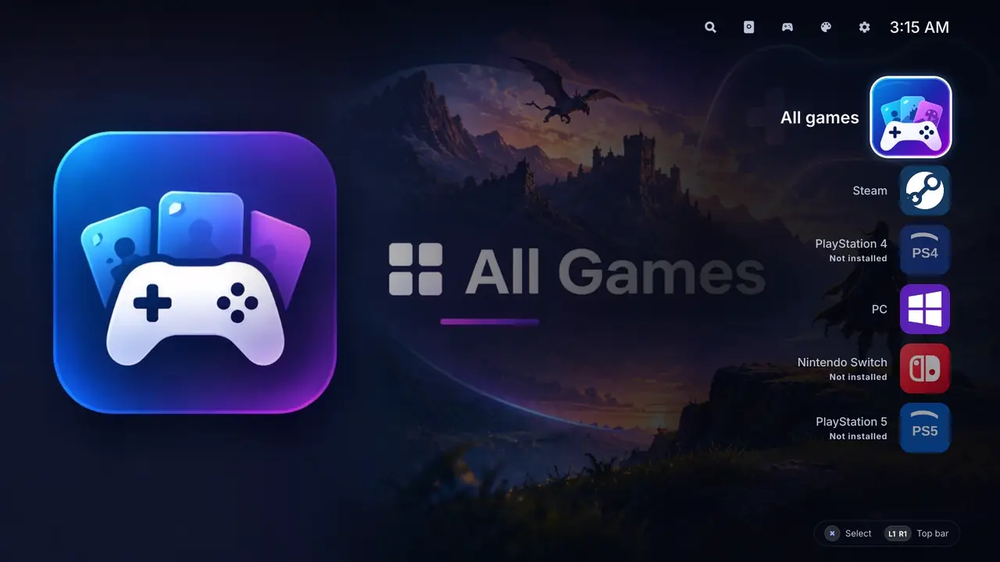

# Marah Launcher

Marah Launcher is a game launcher for a TV and a controller. It puts your games from
emulators, PC folders and Steam in one library, so you can find and play all of them from the
couch, without a keyboard or a mouse.



The demo shows the Default theme with five sample games. `scripts/record_demo.sh` records it.

## What it does

Each emulator has its own window, settings and way to add games, and most of them expect a
keyboard and a mouse. Marah Launcher puts one screen in front of all of them:

- It finds your games, and shows their art and details.
- It downloads and updates the emulators.
- It installs games from packages, disc images and downloads.
- It starts a game, and comes back to the front when the game closes.

It runs on Linux, macOS and Windows. It is also the whole screen of Marah OS.

Each source of games is a plugin built into the launcher:

| Plugin | What it plays | Systems |
| --- | --- | --- |
| PS5 | PS5 games, with [KytyPS5](https://github.com/KytyPS5/KytyPS5) | Linux, macOS, Windows |
| PS4 | PS4 games, with [shadPS4](https://github.com/shadps4-emu/shadPS4) | Linux, macOS, Windows |
| Switch | Switch games, with [Lichii](https://github.com/zortos293/Lichii) | Linux |
| PC | Native games, and Windows games through umu-launcher (Proton) or Wine | Linux, macOS, Windows |
| Steam | The games Steam installed, started through Steam | Linux |

Two service plugins add data. The **Game Catalog** lists the releases each console's catalog
offers to download. The **PlayStation Store** adds official art and details to PS4 and PS5
games.

The launcher ships two themes, **Default** and **Classic**. A theme changes the whole layout,
not only the colours. You can add more themes: a theme is data, and it runs no code.

## Install

Download the file for your system from the
[latest release](https://github.com/MarahHQ/marah-launcher/releases/latest).

| System | File | How to install |
| --- | --- | --- |
| Fedora (x86-64) | `marah-launcher-<version>-1.x86_64.rpm` | `sudo dnf install ./marah-launcher-<version>-1.x86_64.rpm` |
| Debian, Ubuntu (x86-64) | `marah-launcher_<version>-1_amd64.deb` | `sudo apt install ./marah-launcher_<version>-1_amd64.deb` |
| Arch (x86-64) | `marah-launcher-<version>-1-x86_64.pkg.tar.zst` | `sudo pacman -U marah-launcher-<version>-1-x86_64.pkg.tar.zst` |
| Linux (x86-64) | `Marah-Launcher-x86_64.AppImage` | Make it executable and run it. |
| Linux (x86-64) | `marah-launcher-linux-x86_64.tar.gz` | Unpack it and run `./install.sh`. |
| macOS (Apple Silicon and Intel) | `marah-launcher-macos-universal.dmg` or `.zip` | Open the disk image and drag Marah Launcher to Applications, or unzip the app. |
| Windows (x86-64) | `marah-launcher-windows-x86_64-setup.exe` | Run it. It installs for you only, and needs no administrator. |
| Windows (x86-64) | `marah-launcher-windows-x86_64.zip` | Unzip it and run `marah-launcher.exe`. |

Each file has a `.sha256` file beside it, and signed build provenance. To check a file, run
`gh attestation verify <file> --repo MarahHQ/marah-launcher`.

- **The deb, rpm and Arch packages** also add a **Marah Launcher** session to the login screen:
  the launcher as the whole screen, with no desktop behind it.
- **`install.sh`** needs no `sudo`. It puts the launcher in `~/.local/lib/marah-launcher`, links
  `~/.local/bin/marah-launcher` to it, and adds it to your app menu. Set `PREFIX` to use another
  place than `~/.local`. `./install.sh --uninstall` removes the launcher and keeps your
  settings.
- **macOS and Windows** builds are signed only when the release was made with the signing keys.
  An unsigned build makes macOS Gatekeeper ask before the first start, and Windows SmartScreen
  warn.

The launcher updates itself from Settings → Updates → **Marah Launcher updates**.

## Get started

1. Start Marah Launcher. It opens full screen.
2. On the first start, the Welcome screen sets up your folders and emulators. Press ✕ (Enter)
   on **Start** when it is ready.
3. Put your games in `~/Games`, or download one from the Catalog: choose Search in the top bar,
   pick a game, then a release.
4. Open a game's Game Hub and press **Play**.

[Getting started](docs/players/getting-started.md) has the keys and the next steps.

## Documentation

The [documentation index](docs/README.md) lists every page. Start with the one for you:

| You want to | Read |
| --- | --- |
| Play games with the launcher | [Getting started](docs/players/getting-started.md) |
| Make a theme | [Writing a theme](docs/themes/writing-a-theme.md) |
| Add an emulator, a game source or a service | [Writing a plugin](docs/plugins/writing-a-plugin.md) |
| Change the launcher's code | [Development](docs/contributors/development.md) |

The words the code and the docs use are in [GLOSSARY.md](GLOSSARY.md).

## Marah OS

Marah OS turns a PC into a console: it starts straight into Marah Launcher, with no desktop.
Its USB stick, its install and its build are in
[MarahHQ/marah-os](https://github.com/MarahHQ/marah-os).

## Build from source

Install Rust 1.99 or newer and your system's build packages, then run:

```sh
make run       # build and start the launcher
make check     # the format check, clippy and every test, as CI runs them
```

[Development](docs/contributors/development.md) lists the build packages for each system.

## Limits

- Switch and Steam games run on Linux only.
- On Linux, only Windows games run in a sandbox. Linux games, scripts and AppImages run with
  your access to your files. Install only releases you trust.
- On macOS, the launcher needs the Accessibility permission to bring a game to the front and
  come back when it closes.
- On a Wayland desktop other than KDE Plasma, the launcher can't bring a native Wayland game to
  the front.
- The Linux packages are not signed.

## Licence

Marah Launcher is under the GNU General Public License, version 3 or later ([LICENSE](LICENSE)).
The fonts of the built-in themes, Inter and Tajawal, are under the SIL Open Font License 1.1.
Other code, and the libraries the packages ship, keep their own licences: see
[third-party notices](docs/third-party-notices.md).

Inspired by Azrak.
