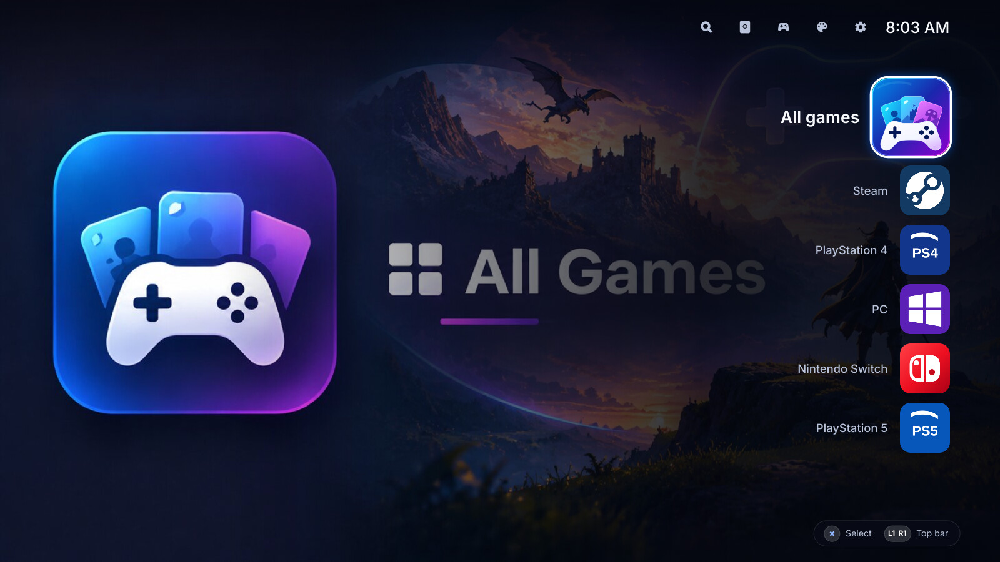
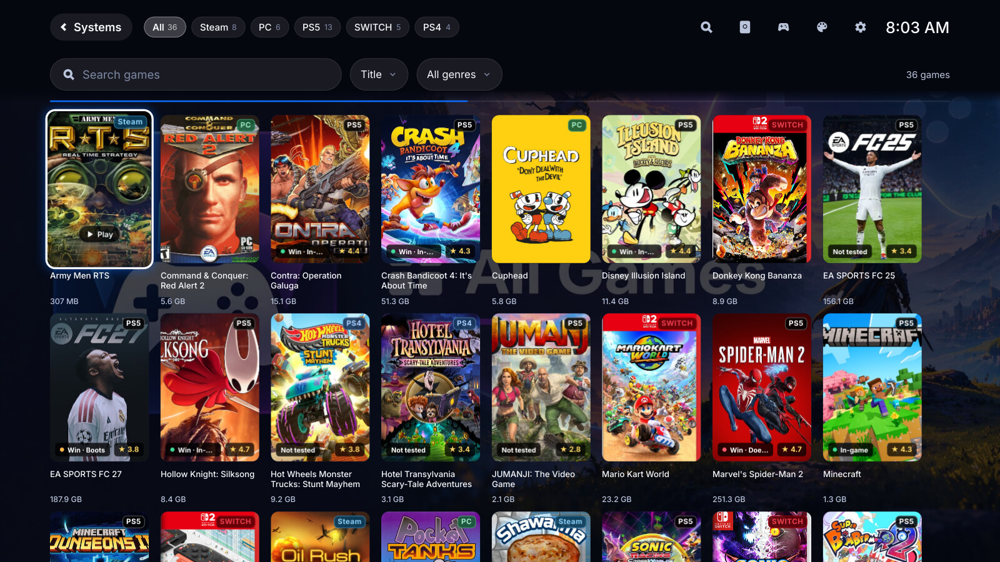

# Marah Launcher

Marah Launcher is a game launcher for a TV and a controller. It puts your games from emulators, PC
folders and Steam in one library, and you play them from the couch. It runs on Linux, macOS and
Windows, and it is the whole screen of Marah OS.

Marah Launcher finds your games, shows their art and details, downloads and updates the emulators,
installs games, starts them, and comes back to the front when a game closes. A keyboard and a
mouse work too.

## What it plays

Each source of games is a plugin built into Marah Launcher.

| Plugin | What it plays | Systems |
| --- | --- | --- |
| PS5 | PS5 games, with [KytyPS5](https://github.com/KytyPS5/KytyPS5) | Linux, macOS, Windows |
| PS4 | PS4 games, with [shadPS4](https://github.com/shadps4-emu/shadPS4) | Linux, macOS, Windows |
| Switch | Switch games, with [Lichii](https://github.com/zortos293/Lichii). Downloads the set firmware release and its matching keys when enabled. | Linux |
| PC | PC games: native games, and Windows games through umu-launcher (Proton) or Wine | Linux, macOS, Windows |
| Steam | The games Steam installed, started through Steam | Linux |

Two service plugins add data. The **Game Catalog** lists the releases each console's catalog
offers to download. The **PlayStation Store** adds official art and details to PS4 and PS5
games.

Marah Launcher ships two themes, **Default** and **Classic**. A theme changes the whole layout, not only
the colours. You can add more themes; a theme is data and runs no code.

## Screenshots

| Home | Library |
| --- | --- |
|  |  |

| Game Hub | Downloads |
| --- | --- |
|  |  |

| Settings | Settings → Backup |
| --- | --- |
|  |  |

The backup browser:

The screenshots show the Default theme at 1600 × 900.

## Install

Download Marah Launcher from the
[latest release](https://github.com/MarahHQ/marah-launcher/releases/latest). Each file has a
`.sha256` file beside it and signed build provenance:
`gh attestation verify <file> --repo MarahHQ/marah-launcher` checks it.

| System | File | How to install |
| --- | --- | --- |
| Fedora (x86-64) | `marah-launcher-<version>-1.x86_64.rpm` | `sudo dnf install ./marah-launcher-<version>-1.x86_64.rpm` |
| Debian, Ubuntu (x86-64) | `marah-launcher_<version>-1_amd64.deb` | `sudo apt install ./marah-launcher_<version>-1_amd64.deb` |
| Arch (x86-64) | `marah-launcher-<version>-1-x86_64.pkg.tar.zst` | `sudo pacman -U marah-launcher-<version>-1-x86_64.pkg.tar.zst` |
| Linux (x86-64) | `marah-launcher-linux-x86_64.tar.gz` | Unpack it and run `./install.sh` |
| Linux (x86-64) | `Marah-Launcher-x86_64.AppImage` | Make it executable and run it |
| macOS (Apple Silicon and Intel) | `marah-launcher-macos-universal.dmg` or `marah-launcher-macos-universal.zip` | Open the disk image and drag Marah Launcher to Applications, or unzip the app |
| Windows (x86-64) | `marah-launcher-windows-x86_64-setup.exe` | Run it. It installs Marah Launcher for you only and needs no administrator. |
| Windows (x86-64) | `marah-launcher-windows-x86_64.zip` | Unzip it and run `marah-launcher.exe` |

`install.sh` needs no `sudo`. It puts Marah Launcher in `~/.local/lib/marah-launcher` (set `PREFIX` to use another
place than `~/.local`), links `~/.local/bin/marah-launcher` to it, and adds Marah Launcher to your app menu. Run
it from a newer package to update. `./install.sh --uninstall` removes Marah Launcher and keeps your
settings.

The deb, rpm and Arch packages also add a **Marah Launcher** session to the login screen: Marah Launcher as the
whole screen, with no desktop behind it.

Marah Launcher updates itself from Settings → Updates → **Marah Launcher updates**. The macOS app and the Windows
program are signed only when the release was made with the signing keys
([docs/signing.md](docs/signing.md)). An unsigned build makes macOS Gatekeeper ask before the
first start, and Windows SmartScreen warn.

To build Marah Launcher from source, see [docs/development.md](docs/development.md). In short: install
Rust 1.99 or newer and your system's build packages, then run `make run`.

## Download Marah OS

Marah OS turns a PC into a console. It starts straight into Marah Launcher, with no desktop.
Its USB stick, how to install it, and how it's built are in [MarahHQ/marah-os](https://github.com/MarahHQ/marah-os). What
Marah Launcher and Marah OS expect from each other is in [docs/marah-os.md](docs/marah-os.md).

## Where to go next

- [docs/user-guide.md](docs/user-guide.md): every screen, the controller keys, backups, where
  Marah Launcher keeps your data, and what to do when something goes wrong.

For contributors:

| Document | What it covers |
| --- | --- |
| [docs/development.md](docs/development.md) | Building, testing, packaging and CI |
| [docs/architecture.md](docs/architecture.md) | How the core, the plugins and the UI host fit together |
| [docs/plugins.md](docs/plugins.md) | Writing a plugin |
| [docs/themes.md](docs/themes.md) | Writing a theme |
| [docs/reference/classic-theme.md](docs/reference/classic-theme.md) | The Classic theme, screen by screen |
| [docs/reference/desktop.md](docs/reference/desktop.md) | Windows, focus and controllers on each system |
| [docs/reference/archives-and-pc-games.md](docs/reference/archives-and-pc-games.md) | Archives in downloads, and PC games |
| [docs/marah-os.md](docs/marah-os.md) | What Marah Launcher and Marah OS expect from each other |
| [docs/signing.md](docs/signing.md) | Signing the release packages |
| [docs/third-party-notices.md](docs/third-party-notices.md) | Code and libraries from other projects, and their licences |
| [GLOSSARY.md](GLOSSARY.md) | The words the code and the docs use |

## Licence

Marah Launcher is under the GNU General Public License, version 3 or later ([LICENSE](LICENSE)). The
fonts of the built-in themes, Inter and Tajawal, are under the SIL Open Font License 1.1. Other
code and the libraries the packages ship keep their own licences: see
[docs/third-party-notices.md](docs/third-party-notices.md).

Inspired by Azrak.
