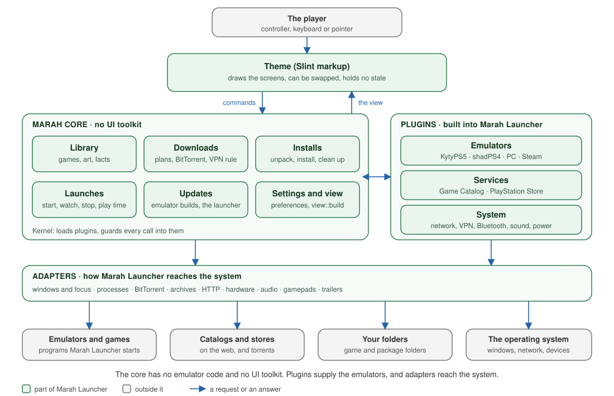
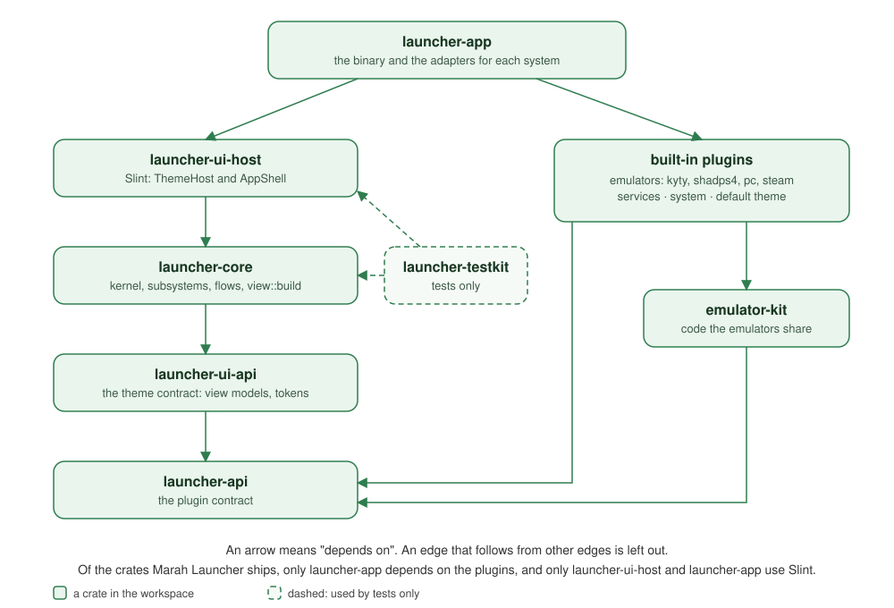
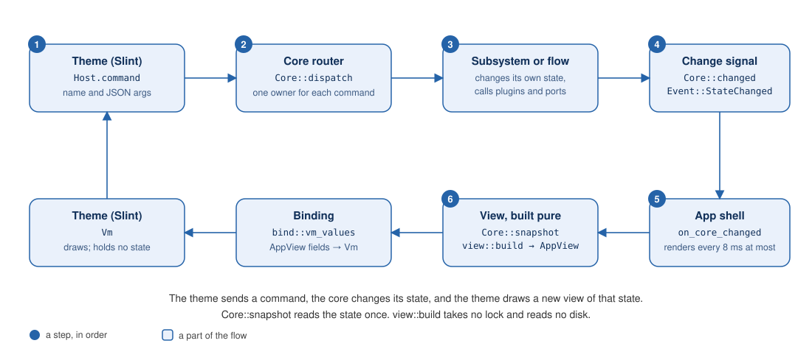

# Architecture

This page shows how the launcher is built, from the crates down to the tests. It is for
contributors who change the core, the UI host or the app. Every name in `code` is a name in the
source: search for it.

The contracts have their own pages: [the plugin reference](../plugins/reference.md) and [the
theme reference](../themes/reference.md). How to build and test is in
[development.md](development.md). The terms are in [the glossary](../../GLOSSARY.md).

## Overview

The player uses a theme. The theme sends commands to the core and draws the view the core
builds. The core works with plugins, and reaches the system through ports. The app fills each
port with an adapter.

The pictures on this page are older than some parts. They don't show the Lichii plugin, the
Classic theme or the backup subsystem. The tables below are the current list.

## Crates

The launcher is one binary, built from one Cargo workspace (`Cargo.toml`). The crate graph is a
boundary: a crate can't use what it doesn't depend on.

An arrow means "depends on". `launcher-app` depends on `launcher-ui-host` and on every built-in
plugin. `launcher-ui-host` depends on `launcher-core`, `launcher-core` on `launcher-ui-api`, and
every crate on `launcher-api`. The emulator plugins also use `emulator-kit`. `launcher-testkit`
serves the tests only.

| Crate | Owns |
| --- | --- |
| `crates/api` (`launcher-api`) | The plugin contract: the plugin traits, `PluginManifest`, `Capability`, `Provided`, `PluginContext`, `Event`. Its version is `API_VERSION`, set by hand. The only crate a plugin depends on. |
| `crates/ui-api` (`launcher-ui-api`) | The theme contract: the view models (`vm.rs`), `ThemeManifest` (`theme.rs`), the tokens (`tokens.rs`), `contract/types.slint`, and the kit (`kit/*.slint`, listed in `KIT` in `contract.rs`). Its version is `UI_API_VERSION`. No UI toolkit code. |
| `crates/core` (`launcher-core`) | The kernel and the app: `Kernel`, `EventBus`, `ConfigService`, the ports (`ports.rs`), `Core` and `Command`, the subsystems, the flows, `Snapshot` and `view::build`. No UI toolkit and no emulator code. |
| `crates/ui-host` (`launcher-ui-host`) | Shows themes with Slint: `ThemeSet` (finds the themes and the fallback theme, checks their files), `ThemeHost` (compiles a theme, binds the view, switches themes) and `AppShell` (carries out the theme's requests, renders, loads images, runs the tick). |
| `crates/app` (`launcher-app`) | The binary: `main.rs`, the command line (`args.rs`), the launcher's own update (`update.rs`), controllers, sounds, trailers, and an adapter for each port. |
| `crates/testkit` (`launcher-testkit`) | `FakeHost`, `FakeClock`, a fake for each port, `FakePlatform`, `StubPlugin`, `FakeBackup`, `FakeCatalog`, `FakeStore`, `FakeService`, `FakeEmulator`, `FakeSystem`, `ThemeDriver`, `MemStorage`, `SpanRecorder` and the contracts (`contract`). |
| `plugins/emulators/*` | `emu-kyty` (PS5), `emu-shadps4` (PS4), `emu-lichii` (Switch and Switch 2, Linux only), `emu-pc` (PC games), `emu-steam` (Steam games, Linux only). |
| `plugins/services/*` | `playstation-store` (store art and details) and `release-catalog` (the Game Catalog). |
| `plugins/system/host` | `system-host`: the system plugin, with the id `system`. |
| `plugins/themes/default`, `plugins/themes/classic` | `theme-default` and `theme-classic`: the built-in themes. Each is a crate only so the binary embeds its files. |
| `plugins/shared/emulator-kit` | Code the emulator plugins share. A library, not a plugin. |
| `tests/` (`launcher-tests`) | The seam tests. |

The graph keeps these rules:

- Of the shipped crates, only `launcher-ui-host` and `launcher-app` use Slint.
- Only `launcher-app` reaches the system: windows, processes, BitTorrent, archives, hardware,
  controllers, sound and trailers. The core reaches them through ports.
- No plugin depends on another plugin. The core names no plugin.
- The workspace denies `unsafe_code` (`[workspace.lints.rust]`). A module that allows it says
  why on the same line. Search for `allow(unsafe_code)` to list them.

A plugin's id, not its folder or its crate, names its data folder and its settings.

## Threads

The core runs on a multi-threaded tokio runtime. The UI runs on the main thread, in Slint's
event loop, where `AppShell` owns the `ThemeHost`. The two meet in two places:

- A theme callback becomes a `UiRequest`. The shell queues it and carries it out later, so a
  request never runs inside the callback that made it. The shell hands core commands and image
  loads to `Platform::spawn`, which runs them on the runtime.
- Core events, controller presses and finished work come back to the UI thread through
  `slint_interpreter::invoke_from_event_loop` (`crates/app/src/main.rs`, `platform.rs`).

The shell has no timer of its own. It reads the time from the core's `Clock` and asks the
platform to wake it with `Platform::wake_in`. The app also calls `AppShell::on_tick` every
`TICK` (250 ms).

## Commands and the view

Data flows one way. A theme sends a command. The core changes its state and names the area that
changed. The shell renders: the view builds from one snapshot and binds into the theme.

1. A theme calls `Host.command(name, args)`. The host reads the name and the JSON args as a
   core `Command` with `serde`: no code exists for each command. The other `Host` callbacks are
   what only the app can do, such as switch the theme or play a sound. The theme reference
   lists them.
2. `Core::dispatch` sends the command to the subsystem or the flow that owns it. Some commands
   nest a subsystem's commands, such as `Command::Backup(BackupCmd)`. Others keep the flat
   names themes send, such as `Command::Back`.
3. The owner changes its state and names the `Area` that changed, through its `Notifier`. That
   sends a `Change` on `Core::changes()` and publishes `Event::StateChanged` on the
   `EventBus`. The core and its tests read the area. The app renders on any change.
4. `main.rs` reads the core's events and calls `AppShell::on_core_changed`. An atomic flag keeps
   at most one call waiting on the UI thread.
5. The shell renders at most once per `RENDER_GAP` (8 ms). Images that arrive later render on
   their own, at most once per `IMAGES_GAP` (100 ms).
6. `ThemeHost::render` calls `Core::view`. That takes a `Snapshot` and runs `view::build` over
   it, which returns an `AppView`. `bind::vm_values` turns the `AppView` into Slint values: each
   field becomes the `Vm` property of the same name in kebab case.

The areas (`Area` in `changes.rs`) are `Navigation`, `Library`, `Catalogs`, `Downloads`,
`Installs`, `Torrents`, `Sessions`, `Notices`, `Settings`, `Plugins`, `System`, `Vpn`,
`Hardware`, `LauncherUpdate` and `Backup`.

`Snapshot` (`snapshot.rs`) holds one read of each subsystem, a copy of `AppState`, the plugins'
manifests, the theme's option values, the time by the core's clock, and what the view needs from
the disk. `view::build` (`view.rs`) is pure: it takes no lock, does no I/O and keeps no state.
Display text, such as sizes and dates, comes from `display.rs`. The view's rules live in pure
modules over the snapshot, each with its own tests: `ownership.rs`, `grid_query.rs`,
`search.rs`, `settings_schema.rs`, `disks.rs`, `game_groups.rs`, `game_words.rs` and
`releases.rs`. `room.rs` holds the free-space rule. The view and the commands both ask it, so a
warning before a click and the refusal on the click agree.

A theme holds no state, so a theme switch loses nothing: the new theme binds to the same
`AppView`. Three tests keep the two sides of the contract together:

- `drift.rs` in `launcher-ui-host` fails when `contract/types.slint` and the view models name
  different fields.
- A test in `crates/ui-host/src/host.rs` calls every function of the kit's `Commands` and fails
  when one sends a command the core can't read.
- `every_view_property_has_a_reader` in `tests/tests/seams/themes.rs` fails when no Slint file
  reads a `Vm` property that isn't on its short list.

## Ports and adapters

The core reaches the outside world through the traits in `crates/core/src/ports.rs`.
`KernelBuilder` starts with a stand-in for each port. The app plugs in the real adapters
(`crates/app/src/main.rs`), and the test kit has a fake for each.

| Port | Stand-in | App adapter | Test fake |
| --- | --- | --- | --- |
| `HttpTransport` | `NoNetwork` | `http::ReqwestTransport` | `FakeHttp` |
| `ProcessSpawner` | `TokioSpawner` | `TokioSpawner` (the stand-in) | `FakeSpawner` |
| `ProcessTree` | `GroupTree` | `processes::SystemProcesses` | `FakeProcessTree` |
| `Windows` | `NoWindows` | `desktop::SystemWindows` | `FakeWindows` |
| `LoginSession` | `NoLoginSession` | `desktop::SystemLoginSession` | `FakeLoginSession` |
| `Opener` | `NoOpener` | `desktop::SystemOpener` | `FakeOpener` |
| `Hardware` | `NoHardware` | `hardware::SystemHardware` | a fixed `Hardware` in `FakeHost` |
| `DriveSpace` | `NoDriveSpace` | `disk::SystemDrives` | a fixed `DriveSpace` in `FakeHost` |
| `Torrents` | `NoTorrents` | `torrents::RqbitTorrents` | `FakeTorrents` |
| `Network` (VPNs) | `NoVpn` | none: a system plugin's `vpn` capability takes its place (`PluginVpn`) | `FakeNetwork` |
| `Archives` | `NoArchives` | `archives::HostArchives` | `FakeArchives` |
| `Clock` | `TokioClock` | `TokioClock` | `FakeClock` |

`TokioSpawner` and `GroupTree` are real adapters, so they live in the core, in `process.rs`.

Boot builds the ports once into one bundle, `Ports`. The bundle also makes the VPN rule
(`VpnRule`) over the `Network` port. `Core::start` splits the bundle, so each subsystem gets
only the ports it names: `Ports::torrents()`, `installs(..)`, `sessions()`, `preferences()`,
`downloads()` and `launcher_update()`.

The app shell has a port of its own: `Platform` (`crates/ui-host/src/shell.rs`). It runs work
off the UI thread, wakes the shell, opens links and paths, quits and restarts, writes the lines
the session script reads (`announce`), plays sounds and trailers, reads the local time, and asks
about monitors and window focus. The app plugs in `platform::SystemPlatform`. Tests plug in
`FakePlatform`, which records each call. How the adapters behave on each system is in
[desktop.md](desktop.md).

## The core

### Subsystems

`Core` (`app.rs`) is a router. It starts the subsystems, sends each command to its owner, joins
their changes into `Core::changes()`, and reads them all into one `Snapshot`.

| Subsystem | Module | Owns |
| --- | --- | --- |
| `TorrentsSubsystem` | `torrents/` | The Catalog's downloads, their phases (`torrents/phase.rs`), the files the player picked (`torrents/picks.rs`) and the VPN kill switch. |
| `GameInstallsSubsystem` | `game_installs/` | Game installs from a download or a package, and the unpack of a download's archives. |
| `LibrarySubsystem` | `library/` | The game records, the catalogs' copies and offers, hidden games, kept art and the player's results. |
| `SessionsSubsystem` | `sessions/` | The running games. See [Sessions](#sessions). |
| `BuildsSubsystem` | `builds.rs` | Each emulator's builds and panels as its plugin last gave them, the install claims, the saved install records (`app.installs.<plugin>`), the updates that wait for a game to close, and the install prompt. |
| `Preferences` | `preferences.rs` | The app's one-value settings (`Pref`), saved as `app.<key>`. |
| `NoticesSubsystem` | `notices.rs` | The notices, at most `MAX_NOTICES` (3). |
| `VpnSubsystem` | `vpn.rs` | "Download only through a VPN" and the VPNs. |
| `LauncherUpdateSubsystem` | `launcher_update.rs` | The launcher's own update. The protocol is in [releasing.md](releasing.md). |
| `BackupSubsystem` | `backup/` | Settings → Backup. See [Backup and restore](#backup-and-restore). |

The emulator downloads run in `Downloads` (`downloads.rs`): one long-lived task that the core
feeds through a channel.

A subsystem keeps these rules:

- It owns its state behind its own lock, and its saved records. Nothing else takes that lock or
  writes those keys.
- It takes only the ports it needs, never the `Kernel` or the `Core`.
- The core sends it commands and reads it whole (`snapshot()`). A read changes nothing.
- It names its changes with its area, through a `Notifier`.
- What other areas must do about a change goes out as an event (`TorrentEvent`,
  `InstallEvent`). The core turns the event into work. A subsystem never calls the core.
- When a command needs another area first, the core resolves it and hands the subsystem plain
  data.

What no subsystem owns stays in `AppState` (`app_state.rs`), behind one mutex in `Core`: the
stack of screens, the grids' queries, the Settings panels, the result prompt, the machine's
state, the stores' installs and the theme on screen.

### Flows

Work that crosses areas is a flow: a free function over the core, in its own module. The core
routes a command to a flow when no one subsystem owns it.

| Flow | Does |
| --- | --- |
| `navigation.rs` | Opens screens on the stack, goes back, selects games, and sets the grids' search, filters, sort and pages. |
| `prefetch.rs` | Fetches the art the player is likely to see next, into the image cache. |
| `library_reads.rs`, `catalog_reads.rs` | Read the plugins for the library and the catalogs. |
| `emulator_builds.rs` | Reads, installs, updates and removes emulator builds, and checks for updates. Each install claims its emulator first (`BuildsSubsystem::claim`). A taken claim refuses the player's install and skips an automatic one. |
| `plugin_downloads.rs` | Starts and resumes a plugin's download plans. |
| `plugin_settings.rs` | Sets plugin settings and theme options, runs plugin actions, maps host folders, turns plugins on or off. |
| `release_downloads.rs` | Resolves the Catalog's downloads and installs, and turns torrent and install events into work. |
| `launch.rs` | Starts games, ends their sessions, and asks "How far did it get?". |
| `ratings.rs` | "Send ratings": shows each of the player's results as a report and opens the list's form. |
| `startup.rs` | The work the boot screen waits for: builds that install at the start, installs a crash stopped, and the plugins' startup work and questions. |
| `closing.rs` | Closes the running games, then what their launches left running, before Log out, Restart and Shut down. |
| `uninstall.rs` | Removes an installed game. |
| `system.rs` | Runs the machine's settings through the system plugin. |
| `backups.rs` | Settings → Backup's commands. |

[ADR 0002](../adr/0002-game-page-reads-stay-as-flows.md) records why the reads for a game's page
stay separate flows.

### Navigation

The core owns where the player is: a stack of visits (`stack.rs`). A visit is one screen, a
`Route`, with the game the player selected on it. Home is at the bottom and never goes.

- `Command::Navigate(route)` opens a screen. Home goes back to the bottom. A screen already on
  the stack goes back to its visit, as the player left it. Any other screen goes on top.
- Opening a game's Game Hub also selects the game on the visit under it, so Back comes back to
  it.
- `Command::Back` pops one visit. `Command::Select` selects a game on the visit on top.
- The view shows the visit on top (`AppView::screen`).
- A running game is no screen. Starting or ending a game leaves the stack as it is.
- An uninstalled game closes its screens (`Stack::forget_game`). The Catalog closes when no
  catalog is left (`Stack::close`).

A theme keeps no screen of its own. It shows the visit on top, keeps only where the keys are
within that screen, and sends what the player asked for.

## Sessions

The sessions subsystem (`sessions/`) owns the running games: their sessions, `game_in_front`,
the one-game-at-a-time claim, Stop, the window focus calls and the play time (`app.playtime`).
`Command::Session(SessionCmd)` carries `Launch`, `Stop`, `ShowGame` and `ToggleFocus`. Its
ports are `ProcessSpawner`, `ProcessTree`, `Windows` and `Clock` (`SessionPorts`).

A launch needs the plugin first, so the core resolves it in `launch.rs`:

1. It claims the subsystem (`SessionsSubsystem::claim`) before its checks, so two presses of
   Play can't both start a game.
2. It asks the builds subsystem whether an install of the game's emulator holds a claim
   (`BuildsSubsystem::busy`): no game starts while its emulator installs.
3. It gets the plugin's `LaunchSpec`, checks the program against `permissions.process`, and
   hands the subsystem a `NewSession` to spawn.

A `LaunchSpec` with a `sandbox` runs through bubblewrap on Linux (`sandbox.rs`). The core
resolves the sandbox's folders like any other path, so a plugin can open to a game only what it
can reach itself. The sandbox is described in
[archives-and-pc-games.md](archives-and-pc-games.md).

The watch (`sessions/watch.rs`) follows the game until it ends. A game is its processes, as
`ProcessTree::members` lists them. It uses the `Windows` port to bring the game to the front,
to keep it there, and to see whether it still has a window. [desktop.md](desktop.md) has the
watch loop and what each system does.

When the game ends, `launch.rs` ends the session and applies one pure rule,
`sessions::outcome` (`sessions/ending.rs`). The rule decides the notice the ending earns and
whether the core asks "How far did it get?".

While a game's window is in front, or the launcher's window doesn't have the focus,
`ThemeHost` drops the controller's presses. Only the Guide button's tap and hold reach the
launcher.

## Backup and restore

Settings → Backup makes one file that holds the app's settings and what each plugin names of
its data. The work splits in three:

- **The plugins name their items.** A plugin with the `backup` capability returns
  `BackupItem`s. It reads and writes nothing itself. The contract is in [the plugin
  reference](../plugins/reference.md).
- **The flow finds the places.** `backups.rs` asks every plugin with the capability for its
  items, under the guard. It resolves each place on this computer through the plugin's grants,
  and hands the paths to the subsystem. A restore writes to a place even when the grant is read
  only: the host writes, and the plugin named the place.
- **The subsystem writes and reads the file.** `BackupSubsystem` (`backup/mod.rs`) knows no
  plugin. It keeps the list of backups, the job in progress and the backup browser's state. Its
  area is `Area::Backup`.

The backup folder is `app.backup_folder` (`Pref::BackupFolder`), else `DEFAULT_FOLDER` in
`backups.rs`: the `backups_folder` of `brand.toml`, in the home folder. A backup's file name is
the `backup_prefix` of `brand.toml`, then the date and time in UTC, then `.tar.gz`
(`file_name` in `backup/archive.rs`). Its entries, in order:

1. `backup.json`: the manifest, with `format`, `launcher` (the version that made it),
   `computer` (the name of the computer that made it), `made` and `items`. It comes first, so
   the list of backups reads only the start of each file.
2. `config.json`: the app's settings in `APP_KEYS`, which name none of this computer's folders,
   and every plugin's settings. The settings that stay on this computer are in `MACHINE_KEYS`.
   A test fails when a key under `app` is in neither list.
3. `items/<plugin>/<item>` for an item that is a file, or `items/<plugin>/<item>/…` for a
   folder. Links are left out.

`FORMAT` (1) is the archive format this build reads. A backup of a later format is listed, but
not restored.

A restore runs in this order:

1. It refuses while a game runs, a game installs, or another backup job runs.
2. It backs up what is here of the items the backup holds, as a backup whose name ends in
   `-before-restore`. If that fails, nothing is restored.
3. It reads the file twice. The first pass checks everything and writes nothing: each entry
   stays inside its item, and each item fits the size the manifest says and the free space
   where it goes. The second pass writes each file through a temporary file. Nothing is written
   through a link.
4. The settings belong to other subsystems while the launcher runs. So the restore leaves them
   in `restored-settings.json` in the data folder, and the job ends with a request to restart.
   At the next start, `Core::start` puts them back (`backup::apply_pending`) before any
   subsystem starts.

### The backup browser

"Restore from another folder" opens the backup browser: a sheet over every screen, drawn by the
kit file `kit/backup-browser.slint` in the launcher's own window, with no system dialog. So it
works on a desktop, in the whole-screen session and on the OS. The core holds its state
(`backup::Browser`) and the view shows it as `Vm.backup.browser`. The theme drives it with
`BackupCmd`: `Browse`, `ShowHidden`, `Filter`, `RestoreFile` and `CloseBrowser`.

- The places (`BrowsePlace`, `PlaceKind`): Home, then Downloads, Desktop and Documents when they
  exist, the backup folder, each drive with its size, then the recent folders.
- A recent folder is one a restore came from. The core keeps the last `RECENT` (5) in
  `app.backup_recent` (`Pref::BackupRecent`). The browser opens at the newest of them, else at
  the backup folder.
- The entries (`BrowseEntry`): the folder's folders with backups, its other folders, then its
  backups, newest first.

## Plugin loading

`crates/api/src/plugin.rs` has one root trait and two kinds of plugin:

- `Plugin`: `manifest()` and `shutdown()`. Every plugin has them.
- `CodePlugin: Plugin` adds `init(ctx) -> Provided`. Emulators, services and system plugins
  implement it.
- `ThemePlugin: Plugin` adds `files()` and no code.

The manifest's `kind` decides privileges only
([ADR 0001](../adr/0001-capabilities-follow-the-capability-not-the-kind.md)). Each capability
is one trait. A plugin returns the ones it has in `Provided`, and must provide exactly the ones
its manifest declares. The core joins answers across plugins only through these traits: one
library from every `Catalog`, one Catalog from every `Releases`. The capabilities and the
built-in plugins that declare them are in [the plugin reference](../plugins/reference.md).

Built-in plugins register at compile time through `PluginFactory`. A crate registers only when
the binary links it, so `crates/app/src/main.rs` names each plugin crate (`use emu_kyty as _;`).

`KernelBuilder` collects candidates from two places:

- `built_in_plugins()`: every `PluginFactory` linked into the binary (`Origin::BuiltIn`).
- `discover(dir)`: each subfolder of `dir` with a manifest (`Origin::ThirdParty`). The app
  discovers `<data folder>/extensions` (or `--extensions`) and the `extensions` folder beside
  the binary (`args::bundled_extensions`).

The launcher has no runtime for third-party code. A third-party plugin must be data-only, and
the only `Loader` is `DataThemeLoader`, so a third-party plugin is a theme. Safe mode refuses
every third-party plugin.

`Kernel::boot` (`kernel.rs`) checks each candidate, orders them by their dependencies
(`resolve.rs`), loads them, and runs `init` on the `eager` ones. Other plugins run `init` on the
first `Kernel::provided` call. Failures go into the `BootReport` and the log, and boot goes on
without them.

`Kernel::enabled` reads `app.disabled_plugins` and `app.enabled_plugins`.
`Command::SetPluginEnabled` changes them. A theme can't be turned off.

Every call into a plugin goes through `Kernel::guard` (`guard.rs`). It opens a `plugin_call`
tracing span with `plugin_id` and `method`, applies a timeout on the kernel's clock, and catches
a panic. The timeout fires at the plugin's next `.await`.

## Themes and the UI host

A theme owns how things look: layout, how the keys move within a screen, tokens, assets, motion
and sound. Which screen shows is the core's. Every theme stands alone, with a shared kit
([ADR 0003](../adr/0003-themes-stand-alone-with-a-shared-kit.md)). What a theme ships, the
files the host serves, the kit and the tokens are in [the theme
reference](../themes/reference.md).

`ThemeSet` (`crates/ui-host/src/themes.rs`) holds the theme plugins the core loaded. Loading a
theme goes like this:

1. `ThemeSet::resolve` checks the theme's `ui_api`, merges its tokens and options
   (`launcher_ui_api::merge`) into a `MergedTheme`, and checks its files: no served file, a
   shell, and every screen. A missing file is an error that names it.
2. `ResolvedTheme::slint_sources` lays the kit down first, then the theme's own `.slint` files
   over it. `contract::lint` checks each file.
3. `compile.rs` adds the files the host serves (`RESERVED_FILES`) and compiles with
   `slint-interpreter`. The compiler's file loader serves only the virtual folder `VFS_ROOT`
   and refuses a path outside it, so markup can't read the disk.
4. `ThemeHost::load` decodes the assets, makes the new tree in the same window, binds the
   tokens, options, assets and view, shows it, and only then drops the old tree. Any failure
   keeps the old theme.

`ThemeSet::fallback` requires exactly one theme with `fallback = true`. `ThemeHost::start_with`
shows the player's theme, and the fallback theme when that fails.

## Data folder

Everything the launcher keeps lives in one data folder. Its place on each system is in
[Where the launcher keeps its data](../players/troubleshooting.md#where-the-launcher-keeps-its-data)
(`args::default_data_dir`). `--data-dir` picks another.

| Path | What |
| --- | --- |
| `config.json` | Every setting: the app's under `app`, each plugin's under `plugins.<id>.<scope>`. |
| `plugins/<id>/` | Each plugin's own folder (`Storage`): emulator builds, caches, the Game Catalog's copies. |
| `logs/<plugin>/<game>.log` | A running game's output. The run before stays as `<game>.previous.log`. |
| `cache/net/` | Images fetched by URL, named by the SHA-256 of the URL. |
| `cache/thumbs/` | Smaller copies of art. |
| `torrents/` | The torrents' data, with the resume data in `torrents/resume/`. `torrents/kept/` holds the bytes of a skipped file that a piece shares with a picked one. |
| `updates/` | A downloaded launcher update and its `ready.json`. |
| `extensions/` | Third-party themes, unless `--extensions` names another folder. |
| `restored-settings.json` | The settings of the last restore, until the next start puts them back. |

Each game's own folder holds its game file (`game_file.rs`, `game_files.rs`):
`launcher_game.json` in the game's root, and its art in `launcher_art/` (`cover.jpg`,
`background.jpg`, `logo.png`, `screenshot_1.jpg` to `screenshot_6.jpg`). The file holds what the
stores and the catalogs said about the game and, for a game the launcher downloaded, the offer
and the release it came from. A plugin may keep its own keys in it, such as the PC plugin's
`starts`. The core keeps every key it doesn't own when it writes, and so does the plugin.

- The library reads a game's file before it asks any store, as the first metadata layer. A
  game with a file is never sent to a store. The records keep each game's folder
  (`app.game_folders`), so the files are read at the next start before any details are.
- Once every game's details are read, each game whose folder its plugin may write, and that has
  no file, gets one. A file on disk is never written over.
- The launcher never renames or deletes the player's own files. Uninstalling a game deletes its
  folder, with the file in it.

Downloaded games aren't in the data folder. They go to the player's `packages` folders and are
installed into the `games` folders. Backups go to the backup folder.

## Startup and shutdown

`crates/app/src/main.rs`, in order:

1. `--probe-controllers` and `--probe-gpu` answer and exit. The arguments parse (`args.rs`).
   `update::apply_launcher_update` puts in a kept launcher update, if there is one.
2. A tokio runtime starts. `Kernel::builder` gets the adapters, `built_in_plugins()` and the
   two `discover` folders, and boots.
3. `Core::start` puts back a restore's settings, starts the subsystems, and starts the
   background work.
4. `--folder` mappings apply as `Command::SetFolders`.
5. `AppShell::new` makes the `ThemeHost`, and `start_with` shows the chosen theme or the
   fallback theme.
6. The controller thread, the core event task and the tick start.
   `Command::Library(LibraryCmd::Refresh)` is sent, the first render runs, and Slint's event
   loop runs.

When the event loop ends, `Core::shutdown` runs for at most `SHUTDOWN_LIMIT` (10 seconds). It
stops the torrents first, so each writes down the pieces it has, then shuts down every plugin.

## Tests

The seam tests are in `tests/`, in one test binary (`tests/tests/seams/main.rs`) with one module
per area. `tests/tests/spans.rs` is its own binary. The seams, from the highest:

1. **The core's API**, through `FakeHost`: commands in; view models, events and errors out. The
   core runs on a `FakeClock`: tokio's time, paused. Time moves when a test moves it, or when
   every task waits for a timer. A test waits for work with `TestCore::until(area, done)` or
   `FakeClock::run_until_idle`.
2. **The contracts** (`launcher_testkit::contract`). Each runs on a fake and on the real
   adapter or plugin:
   - `contract::emulator` on `FakeEmulator` and `FakeCatalog` (`contracts.rs`), and on each
     real emulator plugin in its own seam file (`kyty.rs`, `shadps4.rs`, `lichii.rs`, `pc.rs`,
     `steam.rs`).
   - `contract::archives` on `FakeArchives` and on `HostArchives` (`crates/app/src/archives.rs`).
   - `contract::process_tree` on `FakeProcessTree` and on `SystemProcesses` on Linux
     (`crates/app/src/processes.rs`).
   - `contract::windows` on `FakeWindows` and on `SystemWindows` in the opt-in desktop test
     (`crates/app/tests/desktop.rs`).
   - `contract::torrents` on `FakeTorrents` and on `RqbitTorrents`
     (`crates/app/src/torrents.rs`), opt in.
   - `contract::game_install` on the emulators' game installs.
3. **The composed host**: the core and the `AppShell` the app ships, on Slint's testing backend
   with `FakePlatform`. A test drives the theme through `ThemeDriver` (accessible labels, keys,
   clicks) and checks the view through `core.view()`. `every_theme.rs` runs one suite against
   every built-in theme. `default_theme/` and `classic_theme/` test each theme's own screens.
4. **The desktop adapter against real windows** (`crates/app/tests/desktop.rs`), opt in.

The opt-in tests and their variables are in [development.md](development.md#tests).

Pure rules have table tests beside them, such as the torrent phase rules (`torrents/phase.rs`),
the folder rules (`folders.rs`) and the meaning of a game's end (`sessions/ending.rs`). The kit
rules are tests in `crates/ui-api/src/contract.rs`.

## Decisions

- [ADR 0001: Capabilities follow the capability, not the kind](../adr/0001-capabilities-follow-the-capability-not-the-kind.md)
- [ADR 0002: The reads for a game's page stay as separate flows](../adr/0002-game-page-reads-stay-as-flows.md)
- [ADR 0003: Themes stand alone, with a shared kit](../adr/0003-themes-stand-alone-with-a-shared-kit.md)
