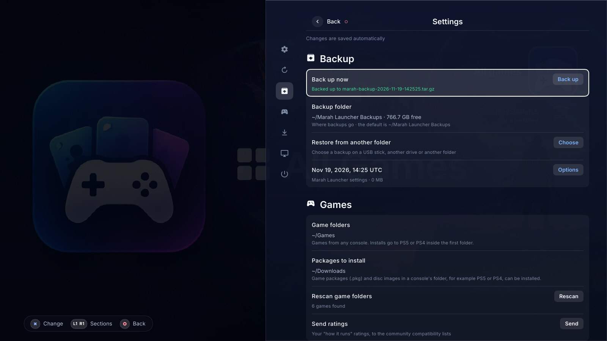
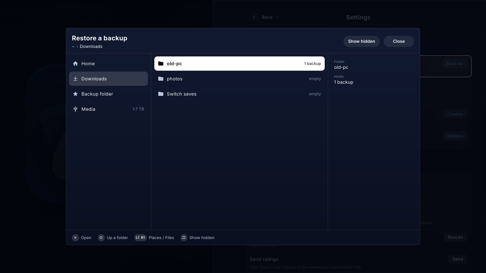

# Backup and restore

This page is for players. It covers how to back up your settings, keys, firmware and saves to
one file, and how to restore that file on this PC or another one.

## Back up

Settings → Backup has these rows:

| Row | What it does |
| --- | --- |
| Back up now | Writes a backup to the backup folder. |
| Include large items | Adds the large items to the next backup only. It shows when a plugin has large items. |
| Backup folder | Where backups go, with the free space on its drive: `~/Marah Launcher Backups` until you choose another. ✕ opens its list: **Choose a folder** (the folder browser, then **Use this folder**), **Type a path**, or **Use the default folder**. |
| Restore from another folder | Opens the folder browser, to restore a backup from a USB stick, another drive or another folder. |
| Restart Marah Launcher | Shows after a restore. It finishes the restore. |
| A backup | One row for each backup in the backup folder, newest first. |

A backup is one file, `marah-backup-<date>-<time>.tar.gz`, with the time in UTC. The file can
hold your console keys. Keep it private.

A backup holds:

- The launcher's settings: play time, hidden games, your results, game art, the theme, which
  plugins are on, sounds, size, updates, and each plugin's settings. Your folders, downloads and
  installed games are not in it: they belong to this computer.
- PS5: "PS5 saves", the KytyPS5 saves folder. The saves of a build without `--data-folder` stay
  in that build's folder, out of the backup.
- PS4: "PS4 settings and saves", shadPS4's data folder without its caches, logs and downloads,
  and without the PS4 system files (`sys_modules`, `fonts`), which the System files block
  downloads again. "PS4 DLC" is a large item.
- Switch: "Switch keys", "Switch firmware and saves", "Switch SD card", "amiibo", "Switch mods",
  "Lichii settings" and "Switch firmware settings".
- PC: "PC games' Wine prefixes", where the games keep their saves. It is a large item.

## Restore

On a backup's row, press ✕ to open its menu. Choose **Restore**, **Delete** or **Cancel** with
Left and Right. Restore and Delete ask you to press ✕ again.

A restore:

1. Backs up what is here now. That backup's row says "Made before a restore".
2. Checks the whole file and the free space before it writes anything into your folders.
3. Puts each item into its folder on this computer, so a backup from another computer works. A
   file in the backup replaces the same file here. Other files stay.
4. Keeps the settings for the next start. Choose **Restart Marah Launcher** to finish.

If a restore stops part of the way, the "before a restore" backup has the files that were here.

Neither a backup nor a restore starts while a game runs or installs, and no game or install
starts during one. When one can't start, the message says why:

- "Close the game first: its files change while it runs"
- "Wait for the game install to finish"
- "A backup or a restore is already running"

## The folder browser

**Restore from another folder** opens the folder browser over the whole screen. It opens at the
last folder you restored from, or else at the backup folder. It is the same folder browser that
**Add folder** opens in Settings → Games, there to pick a folder (see
[Settings](settings.md#games)).

It has three panes:

- **Places**: Home, Downloads, Desktop and Documents when they exist, the backup folder, each
  drive with its size, and under RECENT the last 5 folders you restored from. A drive that isn't
  mounted says "Mount": ✕ mounts it and opens it.
- **Files**: the folders and backups in the folder you are in. A folder says what it holds, such
  as "2 backups", "empty" or "can't be read".
- **Details**: what the focused row is. For a backup: when it was made, the computer that made
  it, its size and what it holds.

| Controller | Keyboard | What it does |
| --- | --- | --- |
| Up, Down | Up, Down | Move in a pane |
| Left, Right, or L1, R1 | Left, Right | Go between the places and the files |
| ✕ | Enter | Open a place or a folder. On a backup, ask to restore it. |
| △ | `/` | Ask to restore the focused backup |
| ○ | Escape | Clear the typed text. Else go up a folder. On the places, or at the top, close the browser. |
| □ | Insert or Ctrl+H | Show or hide hidden folders |
| | Letters | Show only the rows whose name holds the text |
| | Backspace | Take back the last typed letter. With no text, in the files pane, go up a folder. |

With a mouse, one click opens a place or a folder, and one click on a backup asks to restore it.
The path at the top is clickable too: click a folder in it to go there. The mouse wheel scrolls.

A restore asks once, in a dialog: "Restore the backup of <date> from <computer>?". The dialog
starts on **Cancel**. Left and Right move between Cancel and **Restore**. Esc, B (○) or a click
outside the dialog cancels.

The browser lists a backup that a newer version of the launcher made, as "Newer Marah Launcher",
but it doesn't restore it. Update the launcher first.
