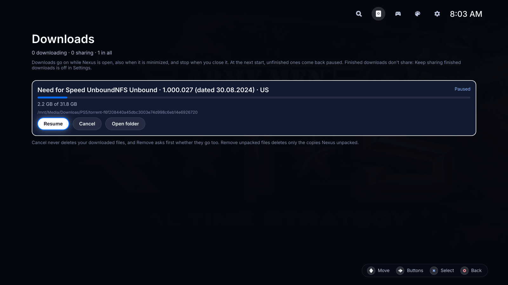

# Downloads and installs

This page is for players. It covers how to download a game from the Catalog, choose its files,
install it, and add a game you already have.

Only download content you are allowed to get and share. While a release downloads, and after it
finishes, the launcher also uploads pieces of it to other players.

## Start a download

A game that a catalog offers lists its releases on its Game Hub, under "RELEASES · RUNS WITH"
and the emulator's name. Each release shows its version, size and availability. Press Down from
the fact cards to reach the releases.

1. Pick a release. "Set up a download" opens. It shows the release and the download folder.
2. Choose **Look up metadata**. The download goes into Downloads, and the launcher reads only
   the torrent's files and size.
3. In Downloads, press **Download** on the download's card. "Choose what to download" opens.

## Choose what to download

"Choose what to download" lists each file of the torrent:

- Each file has a checkbox, its kind (**Game**, **Update**, **DLC** or **Extra**) and its size.
  The game itself is always on: its box is locked. You can leave out updates, DLC and extras,
  such as text files, pictures and soundtracks.
- **Select all** and **Select none** check or uncheck every file. The parts of one archive go on
  and off together.
- The sheet shows the first 100 files. The files after them always download.
- The line above the files says how many files are checked, and their size.
- The sheet shows the free space where the files download and where the game installs. When the
  checked files don't fit, it says so in yellow, and the button that needs the room is off. When
  the download folder and the game folder are on the same drive, **Download and install** needs
  room there for both.
- **Game folder** is where the game goes. Press ✕ on it to type another folder inside a game
  folder.

Then press one of these:

- **Download and install**: the checked files download. When the download finishes, the game
  installs by itself into the game folder, as **Install** does. The launcher checks the game
  folder before anything downloads. If you close the launcher after the download finishes and
  before the install starts, the install starts the next time you open it, once.
- **Download**: the checked files download. You install the game later with **Install**.
- **Not now**: nothing downloads.

Files you leave out never download, and the download folder gets no file for them.

## The Downloads screen

Downloads lists each download from the Catalog, then each emulator build that downloads. Move
between the downloads with Up and Down, and between a card's buttons with Left and Right.

A download's buttons change with its state. They include **Download**, **Resume**, **Retry**,
**Pause**, **Cancel**, **Install**, **Play**, **Stop sharing**, **Remove**, **Remove unpacked
files**, **Cancel install** and **Open folder**. A Steam game shows **Open in Steam**.

- A download goes on while the launcher is open, also when it is minimized. It stops when you
  close the launcher. At the next start, unfinished downloads come back paused.
- **Cancel** stops a download. The downloaded files stay.
- **Remove** asks first. **Remove from Downloads** keeps the files. **Delete files too** also
  deletes the download's own folder, with the files the launcher unpacked. An installed game is
  in another folder, and it stays.
- A problem shows where it happens. A download or an install that fails says why on its card.
  After a failed install the downloaded files stay: press **Install** to try again.

### Sharing

A finished download goes on sharing while the launcher is open, at most 128 KB/s.

- **Stop sharing** stops it until the next start.
- Settings → Downloads → **Keep sharing finished downloads** turns sharing off for every
  download.

A download with files left out shares the files it has, under the same rules. Where a piece of
the torrent holds the end of one file and the start of the next, the launcher keeps the bytes of
the file you left out in its own data folder, at most two pieces for each file. They go when you
remove the download. A download with files left out that an older version of the launcher
finished doesn't share: that version didn't keep those bytes.

## Install a download

Press **Install** on a finished download. The "Install game" sheet shows the game folder the
game goes to. Press **Install** to start.

The launcher unpacks or copies the files into the console's folder inside your first game
folder (`PS5`, `PS4`, `PC` or `Switch`). The install runs in the background, checks the free
space first, never writes over a game that is there, and leaves the downloaded files where they
are. Afterwards, **Remove unpacked files** frees the space of the unpacked copies.

The launcher unpacks RAR, 7z, zip, tar (also gz, xz, bz2 and zst), ISO and cab archives, and
the archive inside a GOG or similar script installer. It never runs anything in a download
while it unpacks. An archive with a password doesn't unpack. The rules are in
[Archives and PC games](../contributors/archives-and-pc-games.md).

## Install a package you have

Each emulator's page offers to install the packages it finds in your packages folders: game
packages and disc images in the console's folder, such as `PS5` or `PS4`, inside a packages
folder. See [Emulators](emulators.md).

## Adding a PC game by hand

A PC game that is already unpacked needs no install:

1. Copy the game's folder into `PC/` in a game folder (`~/Games/PC/` by default). One folder is
   one game.
2. Optional: put a cover in the game's folder, named `cover.jpg`, `cover.png` or `cover.webp`.
3. In Settings → Games, choose **Rescan game folders**.

The launcher looks through the folder once and writes `launcher_game.json` in it. That file
holds the game's name, the files that can start it, and later what the stores say about the
game, with its art in `launcher_art/`. Older versions used other names for these two; the
launcher renames them the first time it reads the folder. A folder whose name starts with `.`
or ends with `.part` is never read.

A game from a download can hold malware. Read [PC games and your files](emulators.md#pc-games-and-your-files)
before you play one.
