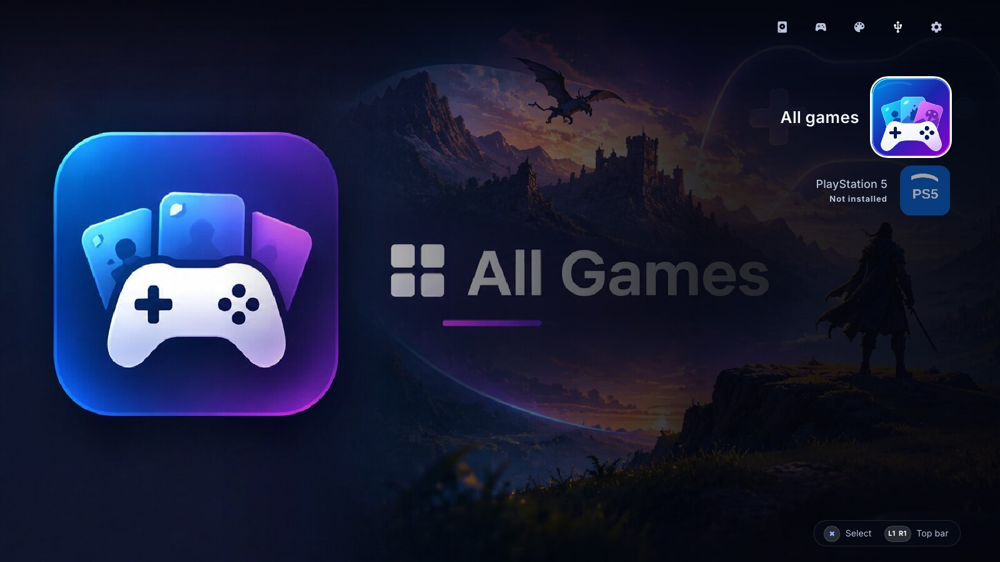
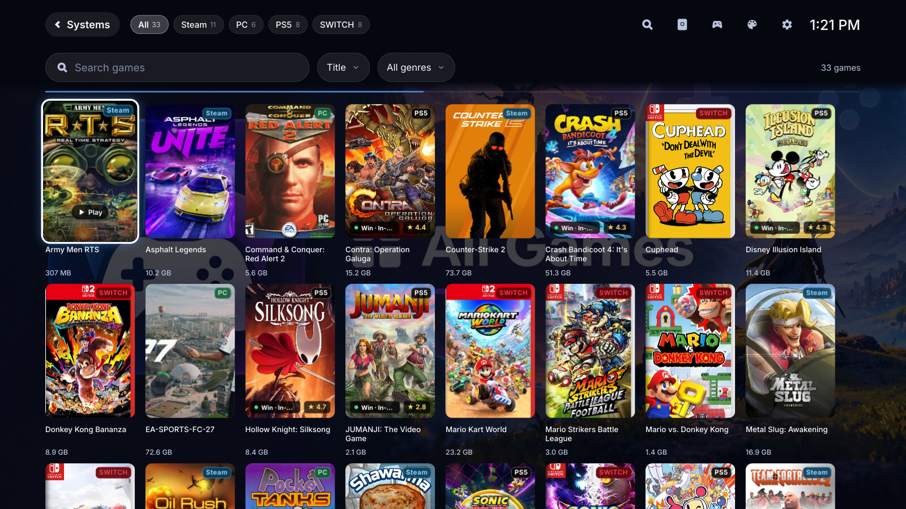
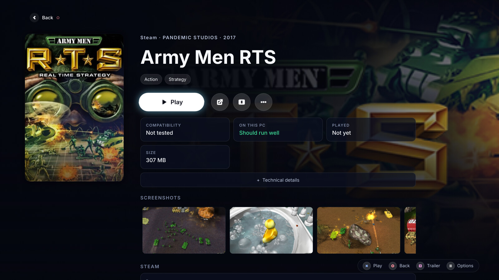

# Finding games

This page is for players. It walks through the screens where you find a game: Home, the
Library, the search, a game's Game Hub and the Catalog.

## Home

Home is a list of your systems on the far side of the screen. "All games" comes first, then one
entry for each emulator. The focused system's picture fills the screen behind the list.

- Press ✕ to open the Library on that system's games.
- Press Options (Menu) to open the system's emulator page.
- Press Up from the first entry to reach the top bar.

A tag under a system tells the emulator's state: "● PLAYING" while one of its games runs, "Not
installed" when it has no build yet, or "Didn't load" when its plugin failed to start.

### The top bar

The top bar holds Search (the Catalog), Downloads, Emulators, Themes and Settings, with the
clock.

- While a game runs, the top bar shows the game with **Resume** and **Stop**.
- While a download runs, it shows the download's progress.
- When the launcher is the whole screen, with no desktop behind it, the top bar also has
  network, sound and Bluetooth icons. Each one opens a panel for its settings.
- On a PC with a battery, it shows the battery level.

When the PC runs on battery and the level falls to 20%, a notice says "Battery at 20%. Plug in
soon." At 10%, a second notice says "Battery at 10%. Save your game and plug in." Each notice
shows once, and shows again after you plug in the PC. The launcher can't show a notice over a
running game: the notice waits until you go back to the launcher.

## Library

The Library is a grid of your games, with the system you opened behind it. Above the grid are
two rows:

1. The systems, in the top bar. ✕ on a system shows only its games.
2. The bar: the search box, the sort, and the genres when there are some.

Up and Down move from the systems to the bar to the grid. In the grid:

- Press ✕ to open the game's Game Hub.
- Type a letter or a digit to start a search with it (keyboard only).
- Press L2 or R2 to move three lines at a time.
- Press ○ to go back to the list of systems.

## Search

The search forgives how you type a name. The best matches come first: a name that is what you
typed, or starts with it, then the names that have each word, then the near spellings. The
search finds:

- Words typed together or apart: "godofwar" and "spider man" find God of War and Spider-Man.
- Initials, with a number at the end: "tlou" finds The Last of Us, "gow" God of War, "re4"
  Resident Evil 4.
- Numbers either way, up to 20: "ff7" and "final fantasy 7" find Final Fantasy VII.
- Names without their accents and punctuation: "pokemon" finds Pokémon.
- A genre, after the names: "racing" finds racing games.
- Small typos, when nothing matches as you typed it: "witchr" finds The Witcher. The first
  letter must be right, and the word needs four letters or more.

In the Catalog, the search also finds a release's title ID, publisher, region and version.

With a controller, the search opens the on-screen keyboard. The row over its keys shows the
best matches as you type. Press Up from the numbers row to reach the row, then ✕ on a game to
open its Game Hub. With nothing typed, the row shows your recent searches: ✕ on one runs it
again, and **Clear** forgets them all.

The launcher keeps your last eight searches, also after a restart. A search counts when you
press Done or Enter, or pick a game in the row.

## Game Hub

The Game Hub is one game's page. It shows the game's art, its rating, its age rating and its
genres. Under them are the buttons:

- **Play**, or **Resume** and **Stop** while the game runs.
- The emulator's actions for the game, when it has some.
- **Store**, when the game has a store page.
- **Trailer**, when the game has a trailer.
- **Options**: the game's menu.

A game from the Catalog also has **Hide** (or **Show**) for the mouse. With a controller, use
the game's menu.

Under the buttons are fact cards: how the game runs, how it should run on this PC, how long you
played, its size, and for some games a compatibility layer's rating (such as ProtonDB's). Press
Down to go on:

1. For a game a catalog offers, the releases come first. See
   [Downloads and installs](downloads.md).
2. Then **Technical details**.
3. Then the screenshots and the ABOUT text. ✕ on a screenshot opens it full screen.

### The game's menu

Press Options (Menu), or pick **Options**, to open the game's menu. It shows only the items the
game has:

- **Game Hub**, when you open the menu from Home.
- The emulator's own actions for the game.
- **Game settings**: the settings of this game only.
- **Open game folder** and **View emulator log**.
- **Watch trailer**.
- **Rate how it runs**. See [Playing](playing.md#rate-how-a-game-runs).
- **Compatibility list**, and the compatibility layer's page (such as "ProtonDB page").
- **Settings**.
- **Hide from the Catalog**, or **Show in the Catalog**, for a game a catalog offers. See
  [Hide a game](#hide-a-game).
- **Uninstall**, for an installed game.

When the launcher is the whole screen, the items that open another program (a folder, a log or
a web page) do not show.

**Uninstall** asks first. It deletes the game's folder from your game folder, with its update
and add-ons. A download the game came from stays in Downloads.

## Catalog

The Catalog lists the games each console's catalog offers to download. Open it with Search in
the top bar. It works like the Library: search, sort, systems and genres above a grid. ✕ on a
game opens its Game Hub, with its releases. ○ goes back to where you opened the Catalog.

The Catalog has three filters among its systems. Each one shows only when it has games:

- **In-game**: only the games that reach gameplay.
- **Installed**: the games you have.
- **Hidden**: only the games you hid. The other views leave them out.

A filter's number is the number of cards it shows, for the system shown. Under **All**, a game
on more than one console counts once. A console chip, such as **PS5**, counts that console's
games.

The Game Catalog plugin gives the catalogs. Its page is under Emulators. With the Game Catalog
turned off, there is no Catalog and no Search button. Its settings include **Catalog address**,
**Sources address**, **Refresh from the forums**, **Show the Hidden filter**, and one "Show
<console> games" switch for each console. A console turned off leaves the Catalog, and its
installed games stay in your Library.

### One card per game

Under **All**, a game that the catalogs offer on more than one console is one card. The card
has a chip for each console, and it stands for the version this PC runs best. A console chip
above the grid, such as **PS5**, shows that console's games, one card each.

Two offers are one game only when there is proof:

- Their titles are the same words without the edition ("Deluxe Edition", "Game of the Year
  Edition" and the other editions the Catalog groups). Case and punctuation don't count.
- They are on two consoles.
- They came out at most four years apart. When a date is missing, both catalogs name a
  publisher, and the two names share a word.

So a sequel ("Alan Wake 2"), a remaster, a remake, a director's cut and a standalone expansion
stay separate cards, because their titles have other words. So do two games of one name years
apart ("Prey" of 2006 and 2017), and titles under three letters long. When a catalog's data
can't decide, the games stay separate.

The game's Game Hub lists its versions under **Versions**, with how each runs on this PC. The
first one is **Best for this PC**, with the reason. Choose another version to open its Game Hub.
With a controller, press Down from the buttons to reach the versions.

On the card, a version you installed stands for the game, so Play starts the game you have.
The card is **New** when any of its versions came to the catalog in the last two weeks.

### Best for this PC

The launcher picks the best version with the same data as the Game Hub's facts. It compares the
versions in this order, and the first difference decides:

1. The version can start on this PC. It can't when its emulator won't start here ("Won't start"
   under On this PC), when its releases are for another system, or when it doesn't start.
2. How far the game gets: your own result first, then the community's list, then a PC release
   made for this system (Playable), then ProtonDB's rating of a Windows release (Platinum and
   Gold count as Playable, Silver and Bronze as In-game, Borked as "Doesn't start"). Not tested
   is below Boots and above "Doesn't start".
3. How well this PC meets what the emulator recommends: Should run well, then May run slowly,
   then Can't tell yet.
4. How much of the PC the version's emulator recommends, less first: the PC's games (no
   recommendation), then shadPS4's PS4 games, then KytyPS5's PS5 games.
5. The Catalog's order: the newest first.

When no version can start on this PC, none is marked best.

The community's list counts for every version, installed or not: the emulator's list gives the
result for the version's title ID. For a version you installed, your own result for the game
comes first, then the list's result. The Game Hub's Compatibility fact, the **In-game** filter
and the Compat sort show the same result. Your result for the installed game also shows as YOUR
RESULT on the version's Game Hub, unless you rated the version itself. A version the list
doesn't know shows "Not tested". The Catalog reads the lists each time it reads the catalogs.

### Hide a game

To hide a game, open its Game Hub and choose **Hide**, or open the game's menu (Options) on its
card or in its Game Hub. For a game on more than one console, the menu has two items:

- **Hide the PS4 version** (named with that version's console): only this version leaves the
  Catalog. Under **All**, the card stands for the other versions, without a chip for the hidden
  one.
- **Hide every version**: the game leaves the Catalog on each console.

With a mouse, the eye on a card under **All** hides every version of the game. Under a console
chip, such as **PS5**, the eye hides only that console's version.

The **Hidden** filter shows what you hid. **Show in the Catalog** on a hidden version shows
every version of the game again.
