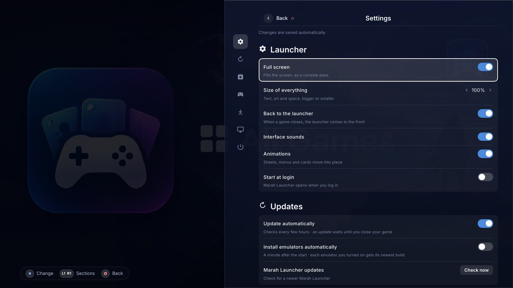

# Settings

This page is for players. It lists every setting, section by section, and covers the Themes
screen and the power menu.

## How Settings works

Settings saves each change at once. It is one page: every section is under its own heading,
with a column of their icons on the left that lights the section you are in. The sections go
in four groups: the launcher itself (Launcher, Updates, Backup), playing (Games, Downloads), the
machine (System, when the launcher is the whole screen, and This PC), and Power last. Settings
opens on Launcher.

- Up and Down move through the rows, from one section into the next.
- L1 and R1 jump to the section before or after.
- Up from the very first row reaches the icons. There, Up and Down choose a section, and Right
  goes into its rows.
- This PC only shows information, so Up and Down pass it by. Jump to it, and Up and Down scroll
  it, and Left comes back to the icons.
- When you scroll the page with the mouse wheel, the icons light the section in view.

## Launcher

| Setting | What it does |
| --- | --- |
| Full screen | Fills the screen, as a console does. On by default. |
| Size of everything | Text, art and space, from 0.8 to 1.4 times. |
| Back to the launcher | When a game closes, the launcher comes to the front. |
| Interface sounds | The theme's sounds for moves, selects, back, starts and errors. |
| Animations | Sheets, menus and cards move into place. Off, they are in place at once, in every theme. On by default. |
| Start at login | The launcher opens when you log in. Only in an installed build. |
| Screen | The monitor the launcher fills. Only with two monitors or more. |

## Updates

| Setting | What it does |
| --- | --- |
| Update automatically | Checks for emulator updates right after the start, then every 6 hours. An update waits until you close your game. |
| Install emulators automatically | At each start, each emulator you turned on that has no build gets its newest build. It skips an emulator that uses your own build. On by default. Turn it off to install each emulator on its first play. |
| Marah Launcher updates | Checks for a new version of the launcher. Then **Download** (or **Update**), then **Restart** to start the new version. |

On Marah OS, the launcher comes with the system's update.

The AppImage downloads only the parts of the new version that changed, and takes the rest from
the AppImage you run. The update shows how much it downloads, for example "12.0 MB of 119.0 MB".
When that can't work, it downloads the whole file.

## Backup

See [Backup and restore](backup.md).

## Games

| Setting | What it does |
| --- | --- |
| Game folders | Where your games are, `~/Games` by default. Installs go into the console's folder inside the first one. ✕ opens the list of folders. |
| Packages to install | Where the emulators look for packages and disc images to install, `~/Downloads` by default. |
| Rescan game folders | Looks for games again. The launcher also looks on its own: at the start, when you add a folder, and when a drive with a game folder comes back. |
| Send ratings | Sends your results ("how far did it get") to the community compatibility lists. See [Playing](playing.md#send-your-ratings). |

✕ on a folder setting opens its list. Each folder shows the free space on its drive, or "Not
there" while its drive is out. A folder you just added says "Scanning…" until the launcher has
looked through it; a notice then says how many games it found. Its games show with no Rescan,
and the games of a folder you take out leave the Library.

- **Remove** takes a folder out of the list. The folder and its files stay.
- **Add folder** opens the folder browser. Go to a folder, on this PC or on a drive, then choose
  **Use this folder** (△). A drive that isn't mounted shows "Mount" in the browser's places:
  choose it to mount the drive and open it.
- **Type a path** adds a folder by its path. Start a path with `~` for your home folder.

## Downloads

| Setting | What it does |
| --- | --- |
| Download only through a VPN | Sends the Catalog's downloads only through your VPN, where the system can do it. |
| Your VPN | The VPN to use. |
| Add a VPN | Adds a VPN, where the system can do it. |
| Keep sharing finished downloads | Other players download from you, at most 128 KB/s. See [Sharing](downloads.md#sharing). |

## System

This section shows only when the launcher is the whole screen, with no desktop behind it: in the
Marah Launcher session on the login screen, or on Marah OS.

- **Internet**, **Sound** and **Bluetooth** open their panels.
- On Marah OS, **Marah OS updates** shows the system's update.
- On the Marah OS USB stick, **Install Marah OS on this PC** starts the install.

## This PC

Your processor, memory and graphics, and how each emulator's games should run on this PC. It
only shows information.

## Power

**Quit Marah Launcher** closes the launcher (Ctrl+Q). When the launcher is the whole screen, the
row reads **Restart Marah Launcher**, and the session starts the launcher again.

- In the Marah Launcher session on a desktop, **Log out** goes back to the login screen.
- When the launcher is the whole screen and the system allows it, **Restart** and **Shut down**
  restart or turn off the PC.
- Log out, Restart and Shut down ask you to press twice. Before they act, they close what runs:
  a running game first, then Steam, when the launcher started it. The screen says what it is
  closing. A game that won't close is ended after a few seconds.

The power menu (hold the PS button, or Ctrl+P) has the same items, from any screen.

At the end of the page, under Power, the About card says what the launcher is: its plugins and
emulators, and its license. Made with Slint is under it.

## Themes

The Themes screen lists the built-in themes, Default and Classic, and the themes the launcher
finds in `extensions` in its data folder and in `extensions` next to the program. Open a theme
and choose **Use this theme**. If the new theme fails to load, the current theme stays.

To write a theme, see [Writing a theme](../themes/writing-a-theme.md).
