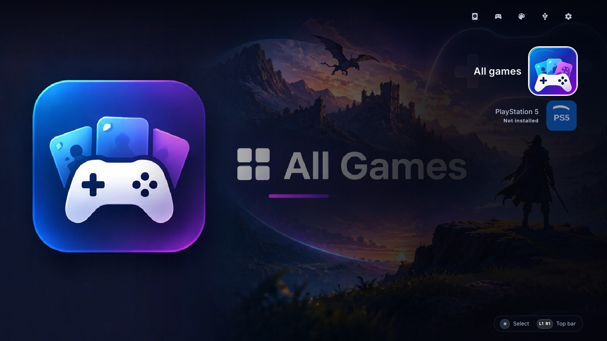
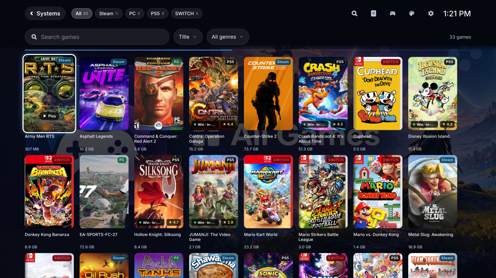
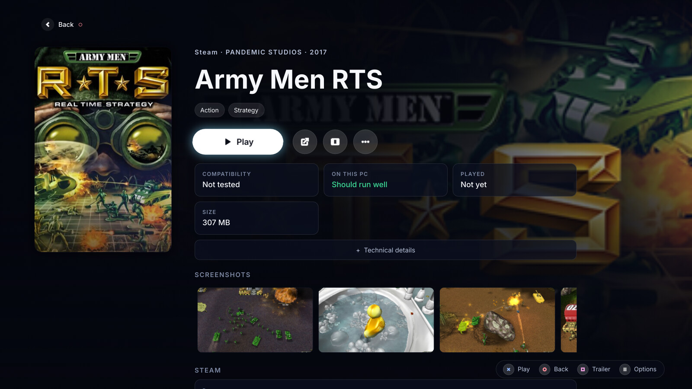
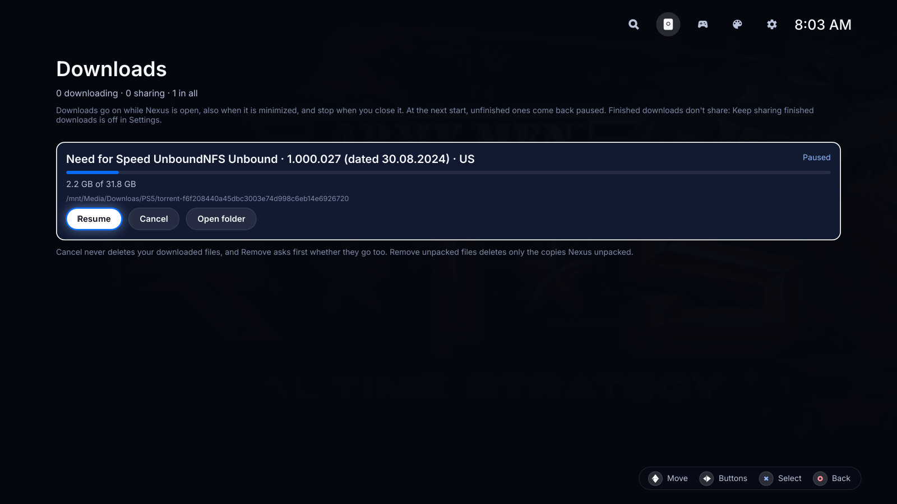
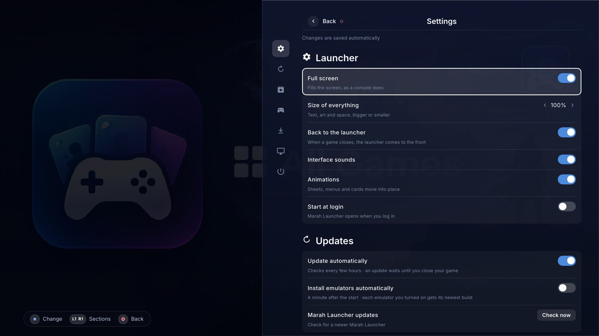
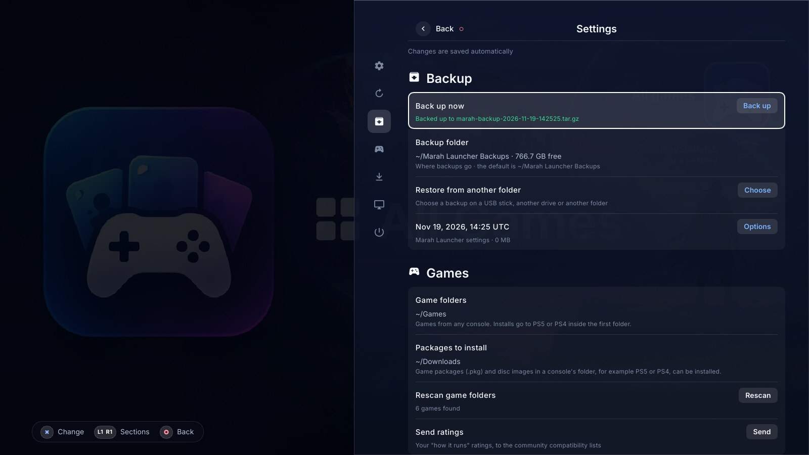
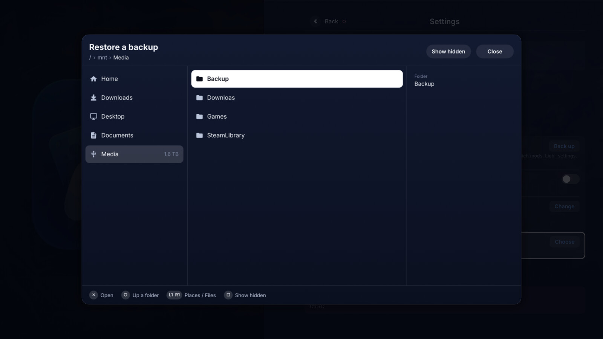

# User guide

This guide is for people who play with Marah Launcher. It walks through each screen, the controller and
keyboard keys, backups, where Marah Launcher keeps your data, and what to do when something goes wrong.
To install Marah Launcher, start at the [README](../README.md).

The guide shows the Default theme. The Classic theme has other layouts for Home and the
Library, but the same keys and the same other screens: see
[reference/classic-theme.md](reference/classic-theme.md).

## First start

Marah Launcher opens full screen. On the first start, a Welcome screen lists what Marah Launcher sets up: your
game folders, each emulator, official artwork and details, and the covers. Press ✕ (Enter) on
**Start** when it is ready.

Marah Launcher looks for games in `~/Games` and for packages to install in `~/Downloads`. To change the
folders, go to Settings → Games.

## Keys

Every screen works with a controller, a keyboard or a mouse. The table names the PlayStation
buttons. On an Xbox controller, ✕ is A and ○ is B.

| Controller | Keyboard | What it does |
| --- | --- | --- |
| D-pad, left stick | Arrow keys | Move |
| ✕ (Cross) | Enter | Select |
| ○ (Circle) | Escape or Backspace | Back |
| △ (Triangle) | `/` | Search. On the Catalog it searches the Catalog, elsewhere the Library. |
| □ (Square) | T or Insert | The shown game's trailer |
| Options | Menu | The shown game's menu. On Home, the focused system's emulator page. |
| L1, R1 | Shift+Tab, Tab | See below |
| L2, R2 | Page Up, Page Down | A page up or down |
| Create (Share, View) | Delete | Close the newest notice |
| PS (Guide), tap | | Go to Home. Does nothing while a game runs. |
| PS (Guide), hold | | Close the running game. With no game running, open the power menu. |
| | Ctrl+P | Open the power menu |
| | Ctrl+D | Open Downloads |
| | Ctrl+Q | Quit Marah Launcher |

L1 and R1 do one of three things:

- On Home and in the Library: move along the top bar, round the ends. ✕ opens the item.
- In Settings, and on a plugin page with two sections or more: jump to the section before or
  after.
- On other screens: go to the screen before or after, in the order Catalog, Downloads,
  Emulators, Themes, Settings, then back to Home.

You hold the PS button for 600 ms to make it a hold. A held ✕ does not repeat: it does not
start, download or install a second time.

While a game is in front, the controller belongs to the game. Marah Launcher reads the controller only
while its own window has the focus. The PS button is the exception: it always reaches Marah Launcher.

With a mouse, click an item to open it. The mouse wheel scrolls.

### Typing with a controller

A text field opens an on-screen keyboard when you reach it with the controller. A physical
keyboard types into the field and the on-screen keyboard stays shut.

| Controller | What it does |
| --- | --- |
| D-pad | Move between keys. In a search, Up from the numbers row reaches the row of matches or last searches. |
| ✕ | Type the key |
| □ | Delete |
| △ | Space |
| L1 | Shift, for one letter |
| R1 | Symbols |
| R2 or Options | Done |
| ○ | Close and keep the text |

## Home

Home is a list of your systems on the far side of the screen. "All games" comes first, then one
entry for each emulator. The focused system's picture fills the screen behind the list.

- Press ✕ to open the Library on that system's games.
- Press Options (Menu) to open the system's emulator page.
- Press Up from the first entry to reach the top bar.

A tag under a system says how its emulator is: "● PLAYING" while one of its games runs, "Not
installed" when it has no build yet, or "Didn't load" when the plugin failed to start.

The top bar holds Search (the Catalog), Downloads, Emulators, Themes and Settings, with the
clock. While a game runs, the top bar shows the game with **Resume** and **Stop**. While a
download runs, it shows its progress. When Marah Launcher is the whole screen (the Marah Launcher session or Marah Launcher
OS), the top bar also has network, sound and Bluetooth icons. Each one opens a panel for its
settings.

On a PC with a battery, the top bar shows its level. When the PC runs on battery and the level
falls to 20%, a notice says "Battery at 20%. Plug in soon." At 10%, a second notice says
"Battery at 10%. Save your game and plug in." Each notice shows once. When you plug in the PC,
the notices show again the next time the level falls. Marah Launcher can't show a notice over a
running game: the notice waits in Marah Launcher until you go back to it.

## Library

The Library is a grid of your games. The system you opened is behind it. It has two rows of
controls above the grid:

1. The systems, in the top bar. ✕ shows only that system's games.
2. The bar: the search box, the sort, and the genres when there are some.

Up and Down move from the systems to the bar to the grid. In the grid:

- Press ✕ to open the game's Game Hub.
- Type a letter or a digit to start a search with it (keyboard only).
- Press L2 or R2 to move three lines at a time.
- Press ○ to go back to the list of systems.

### Search

The search forgives how you type a name. The best matches come first: a name that is what you
typed, or starts with it, then the names that have each word, then the near spellings. The
search finds:

- Words typed together or apart: "godofwar" and "spider man" find God of War and Spider-Man.
- Initials, with a number at the end: "tlou" finds The Last of Us, "gow" God of War, "re4"
  Resident Evil 4.
- Numbers either way, up to 20: "ff7" and "final fantasy 7" find Final Fantasy VII.
- Names without their accents and punctuation: "pokemon" finds Pokémon.
- A genre, after the names: "racing" finds racing games.
- Small typos, when nothing matches as you typed it: "witchr" finds The Witcher. The first
  letter must be right, and a word needs four letters or more.

In the Catalog, the search also finds a release's title ID, publisher, region and version.

With a controller, the search opens the on-screen keyboard. The row over its keys shows the
best matches as you type: press Up from the numbers row to reach it, then ✕ on a game to open
its Game Hub. With nothing typed, the row shows your last searches. ✕ on one runs it again,
and **Clear** forgets them. Marah Launcher keeps your last eight searches, also after a restart.
A search counts when you press Done, Enter or a game in the row.

## Game Hub

The Game Hub is one game's page. It shows the game's art, its rating, its age rating and its
genres. Under them are the buttons:

- **Play**, or **Resume** and **Stop** while the game runs.
- The emulator's actions for the game, when it has some.
- **Store**, when the game has a store page.
- **Trailer**, when the game has a trailer.
- **Options**: the game's menu.

A game from the Catalog also has **Hide** (or **Show**) for the mouse. With a controller, use the
game's menu.

Under the buttons are fact cards: how the game runs, how it should run on this PC, how long you
played, its size, and, for some games, a compatibility layer's rating (such as ProtonDB's).
Press Down to go on. For a game a catalog offers, Down first goes through its releases (see
below). After them, Down opens **Technical details**, then reaches the screenshots and the
ABOUT text. ✕
on a screenshot opens it full screen.

### The game's menu

Press Options (Menu), or pick **Options**, to open the game's menu. It shows only the items the
game has:

- **Game Hub** (when you open the menu from Home).
- The emulator's own actions for the game.
- **Game settings**: the settings of this game only.
- **Open game folder** and **View emulator log**.
- **Watch trailer**.
- **Rate how it runs**.
- **Compatibility list**, and the compatibility layer's page (such as "ProtonDB page").
- **Settings**.
- **Hide from the Catalog**, or **Show in the Catalog**, for a game a catalog offers. For a game
  on more than one console, the menu has **Hide the PS4 version** (with the version's console)
  and **Hide every version** (see
  [One card per game](#one-card-per-game)).
- **Uninstall**, for an installed game.

When Marah Launcher is the whole screen, the items that open another program (a folder, a log, a web
page) do not show.

**Uninstall** asks first. It deletes the game's folder from your game folder, with its update
and add-ons. A download the game came from stays in Downloads.

### Releases and downloads

A game that a catalog offers lists its releases under "RELEASES · RUNS WITH" and the emulator's
name. Each release shows its version, size and availability. Press Down from the fact cards to
reach the releases.

Pick a release to open "Set up a download". It shows the release and the download folder. Choose
**Look up metadata** to add the download to Downloads. Marah Launcher first reads only the torrent's
files and size. Then press **Download** on its card in Downloads to choose the files and start it
(see [Choosing what to download](#choosing-what-to-download)).

Only download content you are allowed to get and share. While a release downloads, Marah Launcher also
uploads pieces of it to other players.

## Catalog

The Catalog lists the games each console's catalog offers to download. Open it with Search in
the top bar. It works like the Library: search, sort, systems and genres above a grid. ✕ on a
game opens its Game Hub, with its releases. ○ goes back to where you opened the Catalog.

The Catalog has three filters among its systems. Each one shows only when it has games:

- **In-game**: only games that reach gameplay.
- **Installed**: the games you have.
- **Hidden**: only the games you hid. Other views leave them out.

Each filter's number is the number of cards it shows. It counts the games of the system shown,
and under **All** a game on more than one console counts once. A console chip, such as **PS5**,
counts that console's games.

### One card per game

Under **All**, a game that the catalogs offer on more than one console is one card. The card
has a chip for each console, and it stands for the version this PC runs best. A console chip
above the grid, such as **PS5**, shows that console's games, one card each.

Two offers are one game only when there is proof:

- Their titles are the same words, without the edition ("Deluxe Edition", "Game of the Year
  Edition" and the others the Catalog already groups). Case and punctuation don't count.
- They are on two consoles.
- They came out at most four years apart. When a date is missing, both catalogs name a
  publisher, and the two names share a word.

A sequel ("Alan Wake 2"), a remaster, a remake, a director's cut and a standalone expansion
have other words, so they stay separate. So do two games of one name years apart ("Prey" of
2006 and 2017), and titles under three letters long. When a catalog's data can't decide, the
games stay separate cards.

The game's Game Hub lists its versions under **Versions**, with how each runs on this PC. The
first one is **Best for this PC**, with the reason. Choose another version to open its Game Hub.
With a controller, press Down from the buttons to reach the versions.

Marah Launcher picks the best version with the same data as the Game Hub's facts. It compares
the versions in this order, and the first difference decides:

1. It can start on this PC. A version can't when its emulator won't start here ("Won't start"
   under On this PC), when its releases are for another system, or when it doesn't start.
2. How far the game gets: your own result first, then the community's list, then a PC release
   made for this system (Playable), then ProtonDB's rating of a Windows release (Platinum and
   Gold are Playable, Silver and Bronze In-game, Borked doesn't start). Not tested is below
   Boots and above "Doesn't start".
3. How well this PC meets what the emulator recommends: Should run well, then May run slowly,
   then Can't tell yet.
4. How much the version's plugin recommends ([requires.recommended] in its manifest), less
   first: a plugin that recommends nothing, such as the PC's, then shadPS4's PS4 games, then
   KytyPS5's PS5 games.
5. The Catalog's order: the newest first.

When no version can start on this PC, none is marked best.

The community's list counts for every version, installed or not: the emulator's list gives the
result for the version's title id. For a version you have installed, your own result for the game
comes first, then the list's result for that game. The Game Hub's Compatibility fact, the
**In-game** filter and the Compat sort show the same result. Your result for the installed game
also shows as YOUR RESULT on the version's Game Hub, unless you rated the version itself. A version the list doesn't know shows
"Not tested". The Catalog reads the lists each time it reads the catalogs.

On the card, a version you have installed stands for the game, so Play starts the game you
have. The card is **New** when any of its versions came to the catalog in the last two weeks.

To hide a game on more than one console, open a version's Game Hub and choose **Hide**, or
open the game's menu (Options) on its card or in its Game Hub. Then pick one of these:

- **Hide the PS4 version** (with that version's console): only this version leaves the Catalog.
  Under **All**, the card stands for the other versions, without a chip for the hidden one. The
  hidden version's console chip no longer shows it.
- **Hide every version**: the game leaves the Catalog on each console.

With a mouse, the eye on a card under **All** hides every version of the game. Under a console
chip, such as **PS5**, the eye hides only that console's version.

The **Hidden** filter shows what you hid. **Show in the Catalog** on a hidden version shows
every version of the game again.

The Game Catalog plugin gives the catalogs. Its page is under Emulators. With the Game Catalog
turned off, there is no Catalog and no Search button. Its settings include **Catalog address**,
**Sources address**, **Refresh from the forums**, **Show the Hidden filter**, and one "Show
<console> games" switch for each console. A console turned off leaves the Catalog. Its
installed games stay in your Library.

## Downloads

Downloads lists each download from the Catalog, then each emulator build that downloads. Move
between the downloads with Up and Down, and between a card's buttons with Left and Right.

A download's buttons change with its state. They include **Download**, **Resume**, **Retry**,
**Pause**, **Cancel**, **Install**, **Play**, **Stop sharing**, **Remove**, **Remove unpacked
files**, **Cancel install** and **Open folder**. A Steam game shows **Open in Steam**.

- A download goes on while Marah Launcher is open, also when it is minimized. It stops when you close
  Marah Launcher. At the next start, unfinished downloads come back paused.
- **Cancel** stops a download. The downloaded files stay.
- **Remove** asks first. **Remove from Downloads** keeps the files. **Delete files too** also
  deletes the download's own folder, with the copies Marah Launcher unpacked. An installed game is in
  another folder and stays.
- A finished download goes on sharing while Marah Launcher is open, at most 128 KB/s. **Stop sharing**
  stops it until the next start. Settings → Downloads → **Keep sharing finished downloads**
  stops it for all of them.

### Choosing what to download

**Download** on a download whose files are read opens "Choose what to download":

- Each file of the torrent has a checkbox, with what it is (**Game**, **Update**, **DLC** or
  **Extra**) and its size. The game itself is always on: its box is locked. Updates, DLC and
  extras, such as text files, pictures and soundtracks, are yours to leave out. **Select all**
  and **Select none** check or uncheck them all. The parts of one archive go on and off
  together. The sheet shows the first 100 files; the files after them always download.
- The line above the files says how many are checked and their size.
- The sheet shows the free space where the files download and where the game installs. When
  the checked files don't fit, it says so in yellow, and the button that needs the room is off.
  When the download folder and the game folder are on the same drive, **Download and install**
  needs room there for the download and the install together.
- **Game folder** is where the game goes. Press ✕ on it to type another folder inside a game
  folder.

Then press one of these:

- **Download and install**: the checked files download. When the download finishes, the game
  installs by itself into the game folder, as **Install** does. Marah Launcher checks the game
  folder before anything downloads. If you close Marah Launcher after the download finishes
  and before the install starts, the install starts the next time you open it, once.
- **Download**: the checked files download, and you install the game later with **Install**.
- **Not now**: nothing downloads.

Files you leave out never download. When the download finishes, Marah Launcher deletes the empty
placeholders the torrent engine made for them. A download with files left out doesn't share
once it finishes: to share it, the torrent engine would make those placeholders again.

A problem shows where it happens. A download that fails says why on its card. An install that
fails says why on the card too, and the downloaded files stay: press **Install** to try again.

### Installing a download

Press **Install** on a finished download. The "Install game" sheet shows the game folder it goes
to. Press **Install** to start. Marah Launcher unpacks or copies the files into the console's folder
inside your first game folder (`PS5`, `PS4`, `PC` or `Switch`). The install runs in the
background, checks the free space first, never writes over a game that is there, and leaves the
downloaded files where they are. **Remove unpacked files** frees the space of the unpacked
copies afterwards.

Each emulator's page also offers to install the packages it finds in your packages folders.

## Playing a game

Press **Play** on the Game Hub. A minute after the start, Marah Launcher installs each emulator
you turned on (see **Install emulators automatically** under [Updates](#updates)). When you press
**Play** before that, or with the setting off, Marah Launcher asks "Install <emulator>?". Choose
**Install and play** to install it and start the game.

A splash shows while the game starts. Without a controller, it lists the emulator's keyboard
keys.

When the game closes, Marah Launcher comes back to the front (Settings → Launcher → **Back to the
launcher**). Marah Launcher may then ask "How far did <game> get?". It asks once for each emulator build.
**Rate how it runs**, in the game's menu, asks again.

Your answer stays on this PC until you send it. See [Send your ratings](#send-your-ratings).

### Send your ratings

Settings → Games → **Send ratings** sends your answers to the community compatibility lists,
so other players know how a game runs. Two lists take reports this way: shadPS4's (PS4 games)
and KytyPS5's (PS5 games). Answers for other emulators, and for PC games, stay on this PC.

1. Marah Launcher lists the answers you haven't sent. All are picked. Press ✕ on one to leave
   it out, then choose **Next: see the reports**.
2. Marah Launcher shows each report in full: its title, every field, the end of the emulator's
   log, and the page it goes to. Move up and down to read all of it.
3. Choose **Open in browser** to open the list's report form, filled in with that text, or
   **Skip** to send nothing. ○ (Escape) closes it; nothing more is sent.
4. Submit the report on the page that opened. You need a free GitHub account for it. Marah
   Launcher holds no account and sends nothing itself.

Before the report shows, Marah Launcher takes personal data out of the log: your home folder
becomes `~`, your user name `<user>`, your computer's name `<computer>`, IP addresses `<ip>`
and email addresses `<email>`. Check the text before you submit it.

An answer you opened in the browser counts as sent and isn't listed again. A new answer for the
same game is listed again. shadPS4's form has a checklist that you tick yourself: shadPS4 takes
reports only for a game dumped from a copy you own, unmodified, on a major release of shadPS4.

To close a running game, hold the PS button, or choose **Stop** in the top bar or the Game Hub.

## Emulators

Emulators lists the emulator plugins, then the service plugins (Game Catalog and PlayStation
Store). Each row says whether the plugin is installed, and whether it is on. Press ✕ to open a
plugin's page beside the list.

A plugin's page has:

- **Turned on**: turns the plugin on or off.
- The build, for an emulator Marah Launcher installs: install or update it, or **Uninstall** it.
- The plugin's actions.
- Its settings, and its folders.

The page is one page, as Settings is. Each section is under its own header: **General**, one
section for each group of settings (one named **Settings** when there is one group), then
**Folders** when there is no group of settings to hold them. With two sections or more, a rail
of their icons is beside the page. L1, R1 and the rail jump to a section, and Up and Down go on
across the sections.

For KytyPS5, shadPS4 and Lichii, Marah Launcher downloads the official builds and keeps the build before
the current one. To run a build of your own, map its folder on the emulator's page: "Your own
KytyPS5 build", "Your own shadPS4 build" or "Your own Lichii build".

Some emulator notes:

- **KytyPS5**: a build that knows the `--data-folder` option keeps its saves in one folder that
  every such build shares: "KytyPS5 saves" on its page, `~/.local/share/KytyPS5` until you
  change it.
- **shadPS4**: some PS4 games need the PS4's system modules and fonts: 14 `.sprx` files in
  `sys_modules` and 45 fonts in `fonts/font` and `fonts/font2`, in **shadPS4 data**
  (`~/.local/share/shadPS4` until you change it). If any of them are missing, a question comes up
  over the boot screen: **Install PS4 system files?** **Install** downloads the missing files,
  about 38 MB for all of them, from the
  [retrobios collection](https://github.com/Abdess/retrobios) on GitHub, at a fixed commit.
  Marah Launcher checks the size and SHA-256 of each file before it puts the file in place. The
  boot screen shows the download and waits for it. **Not now** downloads nothing, and the start
  asks again next time. The **System files** block on the PS4 page shows the files:
  **Installed**, **Missing** and how many, or **Your own files**. **Install now** installs the
  missing files at once. Turn off **Ask at start** in the same block, and the start no longer
  asks. Files you put there yourself are never replaced, and files that aren't
  on the list are never touched. If a download fails, or a file doesn't match its SHA-256, the
  block says why, the boot goes on, and no half-written file is left in shadPS4's folders. These
  are Sony's files: check that you may use them where you live.
- **shadPS4's touchpad button**: a PS1 game on PS4, such as Tekken 3, reads a click on the right
  half of the touchpad as START and on the left half as SELECT. A controller with no touchpad
  clicks with its **Back** (or **View**) button, and shadPS4's own key map clicks the centre,
  which is neither: the game waits at "Press START". Before each PS4 game, Marah Launcher sets
  shadPS4's key map (`input_config` in **shadPS4 data**) so that **Back** and **Space** click the
  right half (START) and **Backspace** the left half (SELECT). It changes only shadPS4's own
  touchpad lines: a touchpad you mapped to other keys stays as it is.
  In a PS1 game on PS4 the Options button does nothing, so before a PS1 game Marah Launcher
  also makes the controller's **Start** START and **Back** SELECT; before a PS4 game, Start is
  Options again. In a PS1 game, Options is on the keyboard only (**Enter**). A PS1 game is a
  PS4 game folder with `config-title.txt` and a `.cue` disc in `data/`.
- **shadPS4's Save Migration box**: at its first start, shadPS4 asks what to do with saves in
  its old place (`savedata/1`), in a box a controller can't answer. When there are no such saves,
  Marah Launcher makes shadPS4's first user (`home/1000`) before the first PS4 game, so the box
  doesn't come up. When there are, shadPS4 asks: **Copy** keeps the old saves as well, **Do
  nothing** leaves them where they are.
- **Lichii**: Lichii keeps its data in `~/.local/share/lichii` from build-150 on. If you
  played with an older build, open Lichii from its page once and import your Eden data
  (`~/.local/share/eden`): until then, Lichii starts no game. An older build, or your own
  build from before build-150, still reads `~/.local/share/eden`: set **Lichii data** on
  Lichii's page to that folder. For firmware and keys, use the
  **Firmware** block on Lichii's page. It shows the firmware installed and the update that runs,
  with a bar while it downloads. With **Ask at start** on, as it is by default, each start
  checks for the set release. If no firmware is there, or Marah Launcher installed an older one,
  a question comes up over the boot screen: **Install** downloads it, and the boot screen shows
  the download and waits for it. **Not now** downloads nothing, and the start asks again next
  time. The checks every 6 hours and a visit to Lichii's page never download: the block shows
  **Available** and the firmware it would install. Firmware you put there yourself is left
  alone. **Update now** installs at once. Marah Launcher downloads the **Firmware release** set
  in that block from
  [THZoria/NX_Firmware](https://github.com/THZoria/NX_Firmware), checks its SHA-256 against the
  one GitHub gives, and puts it in place of the firmware in that folder. Lichii uses it from its next
  start. `prod.keys` and any `title.keys` from the versioned archive at
  `https://files.prodkeys.net/ProdKeys.NET-v<firmware_release>.zip` go into the `keys` folder:
  the keys always match the firmware, because firmware newer than its keys can't be read and
  Lichii hangs on its start. **Firmware release** defaults to `22.5.0`. To use another one,
  select the row, press Enter, and type a version that both sites have, like `22.1.0`. Then
  press **Update now**.
  The badge beside the button names the firmware version Marah Launcher installed. This is
  Nintendo's firmware: check that you may use it where you live. If an update fails, the old
  firmware stays.
  Games have internet access: **Airplane mode** on the Switch page's **Settings** tab is off.
  Turn it on to keep every Switch game offline. This applies to the games Marah Launcher starts with an
  official build. Your own build and Lichii's window use the airplane mode in Lichii's own
  settings file (`qt-config.ini`), which is on until you turn it off in Lichii's window. If
  Lichii's own settings file can't be read, the game doesn't start and Marah Launcher says why.
- **PC**: a Windows game runs through umu-launcher (Proton) or Wine. The PC page has **Install
  umu-launcher**, and then **Update umu-launcher**. On Linux a Windows game runs in a sandbox:
  see [PC games and your files](#pc-games-and-your-files).
- **Steam**: Marah Launcher reads Steam's folder and every library Steam lists. Set **Steam libraries**
  only to read other folders. In the Catalog, the Steam system lists the games in your Steam
  collections. Install and Uninstall ask Steam, in Steam's own dialogs.

### PC games and your files

A game from a download can hold malware. On Linux, Marah Launcher runs each Windows game in a sandbox
made with bubblewrap. The game sees its own folder and its Wine prefix. It doesn't see your
home folder, your other games or your other files. Sound, the display, controllers and the
network work as usual.

- The **Sandbox** setting in the game's Game settings is on by default. Turn it off only for a
  game that doesn't run in the sandbox. It then runs with your access to every file.
- The first Windows game you play in the sandbox downloads Proton into Marah Launcher's own folder.
  That takes a few minutes, once.
- A game in the sandbox runs without GameMode.
- Linux games, scripts and AppImages don't run in the sandbox: they keep their saves in your
  home folder. Install only releases you trust.

### Adding a PC game by hand

A PC game that is already unpacked needs no install:

1. Copy the game's folder into `PC/` in a game folder (`~/Games/PC/` by default). One folder is
   one game.
2. Optional: put a cover in the game's folder, named `cover.jpg`, `cover.png` or `cover.webp`.
3. In Settings → Games, choose **Rescan game folders**.

Marah Launcher looks through the folder once and writes `launcher_game.json` in it. That file holds the
game's name, the files that can start it, and later what the stores say about the game, with
its art in `launcher_art/`. Versions 0.2.0 and 0.3.0 named them `marah_game.json` and `marah_art/`:
Marah Launcher renames them the first time it reads the folder. A folder whose name starts with `.` or ends with
`.part` is never read. The full rules are in
[reference/archives-and-pc-games.md](reference/archives-and-pc-games.md).

## Themes

Themes lists the built-in themes, Default and Classic, and the themes Marah Launcher finds in
`extensions` in its data folder and in `extensions` next to the program. Open a theme and choose
**Use this theme**. If the new theme fails to load, the current theme stays.

## Settings

Settings saves each change at once. It is one page: every section under its own heading, with a
column of their icons on the left that lights the section you are in. Up and Down move through
the rows, from one section into the next. Press L1 and R1 to jump to the section before or after.
You can also press Up from the very first row to reach the icons, Up and Down to choose one, and
Right to go into its rows. This PC only shows, so Up and Down pass it by: jump to it, and Up and
Down scroll it, and Left comes back to the icons. When you scroll the page with the mouse wheel,
the icons light the section in view.

### Launcher

| Setting | What it does |
| --- | --- |
| Full screen | Fills the screen, as a console does. On by default. |
| Size of everything | Text, art and space, from 0.8 to 1.4 times. |
| Back to the launcher | When a game closes, Marah Launcher comes to the front. |
| Interface sounds | The theme's sounds for moves, selects, back, starts and errors. |
| Animations | Sheets, menus and cards move into place. Off, they are in place at once, in every theme. On by default. |
| Start at login | Marah Launcher opens when you log in. Only in an installed build. |
| Screen | The monitor Marah Launcher fills. Only with two monitors or more. |

### Games

Your **Game folders** and **Packages to install**. Separate several folders with `;`. Start a
path with `~` for your home folder. **Rescan game folders** looks for games again.
**Send ratings** sends your "how it runs" answers to the community compatibility lists: see
[Send your ratings](#send-your-ratings).

### Updates

| Setting | What it does |
| --- | --- |
| Update automatically | Checks for emulator updates right after the start, then every few hours. An update waits until you close your game. |
| Install emulators automatically | Right after the start, each emulator you turned on that has no build gets its newest build. It skips an emulator that uses your own build. On by default. A first start downloads a few hundred MB. Turn it off to install each emulator on its first play. |
| Marah Launcher updates | Checks for a new Marah Launcher. Then **Download** (or **Update**), then **Restart** to start the new version. |

On Marah OS, Marah Launcher comes with the system's update.

The AppImage downloads only the parts of the new version that changed. The rest comes from the
AppImage you run. The update shows how much it downloads, for example "12.0 MB of 119.0 MB". When
that can't work, it downloads the whole file.

### Downloads

| Setting | What it does |
| --- | --- |
| Download only through a VPN | Sends the Catalog's downloads only through your VPN. Where the system can do it. |
| Your VPN | The VPN to use. |
| Add a VPN | Adds a VPN. Where the system can do it. |
| Keep sharing finished downloads | Other players download from you, at most 128 KB/s. |

### This PC

Your processor, memory and graphics, and how each emulator's games should run on this PC. It
only shows information.

### System

Only when Marah Launcher is the whole screen. **Internet**, **Sound** and **Bluetooth** open their
panels. On Marah OS, **Marah OS updates** shows the system's update. On the Marah OS USB stick,
**Install Marah OS on this PC** starts the install.

### Backup

See [Backup and restore](#backup-and-restore).

### Power

**Quit Marah Launcher** closes Marah Launcher (Ctrl+Q). When Marah Launcher is the whole screen it reads **Restart Marah Launcher**,
and the session starts Marah Launcher again. In the Marah Launcher session on a desktop, **Log out** goes back to
the login screen. When Marah Launcher is the whole screen and the system allows it, **Restart** and
**Shut down** restart or turn off the PC. Log out, Restart and Shut down ask you to press twice.
Before they act, they close what runs: a running game first, then Steam, when Marah Launcher started it.
The screen says what it is closing; a game that won't close is ended after a few seconds.

The power menu (hold the PS button, or Ctrl+P) has the same items, from any screen.

## Backup and restore

Settings → Backup keeps your settings, keys, firmware and saves in one file.

| Row | What it does |
| --- | --- |
| Back up now | Writes a backup to the backup folder. |
| Include large items | Adds the large items to the next backup only. It shows when a plugin has large items. |
| Backup folder | Where backups go. `~/Marah Launcher Backups` until you type another. Empty text goes back to it. |
| Restore from another folder | Opens the backup browser, to restore a backup from a USB stick, another drive or another folder. |
| Restart Marah Launcher | Shows after a restore. Finishes it. |
| A backup | One row for each backup in the backup folder, newest first. |

A backup is one file, `marah-backup-<date>-<time>.tar.gz`, with the time in UTC. It holds:

- Marah Launcher's settings: play time, hidden games, your results, game art, the theme, which plugins
  are on, sounds, size, updates, and each plugin's settings. Your folders, downloads and
  installed games are not in it: they belong to this computer.
- PS5: "PS5 saves", the KytyPS5 saves folder. Saves of a build without `--data-folder` stay in
  that build's folder and out of the backup.
- PS4: "PS4 settings and saves", shadPS4's data folder without its caches, logs and downloads,
  and without the PS4 system files (`sys_modules`, `fonts`): the System files block downloads
  them again.
  "PS4 DLC" is a large item.
- Switch: "Switch keys", "Switch firmware and saves", "Switch SD card", "amiibo", "Switch mods",
  "Lichii settings" and "Switch firmware settings".
- PC: "PC games' Wine prefixes", where the games keep their saves. A large item.

The file can hold your console keys. Keep it private.

### Restore a backup

On a backup's row, press ✕ to open its menu. Choose **Restore**, **Delete** or **Cancel** with
Left and Right. Restore and Delete ask you to press ✕ again.

A restore:

1. Backs up what is here now. That backup's row says "Made before a restore".
2. Checks the whole file and the free space before it writes anything into your folders.
3. Puts each item into its folder on this computer, so a backup from another computer works. A
   file in the backup replaces the same file here. Other files stay.
4. Keeps the settings for the next start. Choose **Restart Marah Launcher** to finish.

If a restore stops part of the way, the "before a restore" backup has the files that were here.
Neither a backup nor a restore starts while a game runs or installs. No game or install starts
during one.

### The backup browser

**Restore from another folder** opens the backup browser over the whole screen. It opens at the
last folder you restored from, or else at the backup folder.

It has three panes:

- **Places**: Home, Downloads, Desktop and Documents when they exist, the backup folder, each
  drive with its size, and under RECENT the last 5 folders you restored from.
- **Files**: the folders and backups in the folder you are in. A folder says what it holds,
  such as "2 backups", "empty" or "can't be read".
- **Details**: what the focused row is. For a backup: when it was made, the computer that made
  it, its size and what it holds.

| Controller | Keyboard | What it does |
| --- | --- | --- |
| Up, Down | Up, Down | Move in a pane |
| Left, Right, or L1, R1 | Left, Right | Go between the places and the files |
| ✕ | Enter | Open a place or a folder. On a backup, ask to restore it. |
| △ | `/` | Ask to restore the focused backup |
| ○ | Escape | Clear the typed text. Else go up a folder. On the places, or at the top, close the browser. |
| □ | Insert or Ctrl+H | Show or hide hidden folders |
| | Letters | Show only the rows whose name holds the text |
| | Backspace | Take back the last typed letter. With no text, in the files pane, go up a folder. |

With a mouse, one click opens a place or a folder. One click on a backup asks to restore it.
The path at the top is also clickable: click a folder in it to go there. The mouse wheel
scrolls.

A restore asks once, in a dialog: "Restore the backup of <date> from <computer>?". The browser
lists a backup that a newer Marah Launcher made, as "Newer Marah Launcher", but does not restore it. Update Marah Launcher
first.

## Where Marah Launcher keeps your data

Marah Launcher keeps its settings and the plugins' data in one folder:

| System | Folder |
| --- | --- |
| Linux | `~/.local/share/marah-launcher` (or `$XDG_DATA_HOME/marah-launcher`) |
| macOS | `~/Library/Application Support/marah-launcher` |
| Windows | `%APPDATA%\marah-launcher` |

`marah-launcher --data-dir <path>` uses another folder for one run. Inside the folder:

| Path | What it holds |
| --- | --- |
| `config.json` | Your settings |
| `plugins/<plugin>/` | Each plugin's data, such as the emulator builds |
| `logs/<plugin>/` | Each game's log, which **View emulator log** opens |
| `torrents/` | The Catalog's downloads' state |
| `cache/` | Thumbnails and cached downloads from the network |
| `updates/` | A Marah Launcher update waiting for the next start |
| `extensions/` | Themes you add |
| `restored-settings.json` | The settings of a restore, until the next start puts them back |

Your games, packages and backups are in the folders you chose in Settings, not in this folder.
The emulators keep some data in their own folders, such as "KytyPS5 saves" and "shadPS4 data".
Each one is on its emulator's page.

## Troubleshooting

**A theme doesn't load.** At the start, Marah Launcher shows the Default theme in its place. When you
switch themes, the current theme stays. To start with the Default theme
and the built-in plugins only, run `marah-launcher --safe-mode`.

**An emulator says "Didn't load" on Home.** Its plugin failed to start. Run Marah Launcher from a
terminal to see why: the log goes to the terminal. Set `RUST_LOG` to change how much it says
(`info` by default).

**A game doesn't start, or crashes.** Open the game's menu and choose **View emulator log**.

**The Marah Launcher session restarts or shows a black screen.** The session writes its log to
`~/.cache/marah-session.log`. To change the session's settings, copy a line from
`/usr/share/marah-launcher/session.conf` to `/etc/marah-launcher/session.conf`.

**A Windows game doesn't start.** Install umu-launcher from the PC page (Emulators → PC), or
install Wine. If the message says to install bubblewrap, install the `bubblewrap` package. If
the game starts but fails in the sandbox, turn off **Sandbox** in its Game settings.

**An old PC game shows in a corner of the screen** (Linux). Set its **Resolution** in its Game
settings. It then runs inside gamescope, which needs to be installed.

**A RAR or another archive doesn't unpack.** The error names what is missing: libarchive, or
`unar` for some RAR files. The release packages ship libarchive.

**A trailer opens in the browser.** Marah Launcher plays trailers in its window with libmpv. Without
libmpv, it opens them in the browser.

**A backup or restore doesn't start.** The message says why:

- "Close the game first: its files change while it runs"
- "Wait for the game install to finish"
- "A backup or a restore is already running"

**A backup in the browser can't be restored.** A newer Marah Launcher made it. Update Marah Launcher first.

**Everything is too small or too big on the TV.** Change Settings → Launcher → **Size of
everything**. `MARAH_SCALE=<0.8 to 1.4>` sets it for one run.

## Command-line options

`marah-launcher --help` lists them:

| Option | What it does |
| --- | --- |
| `--theme <id>` | Show this theme now (not saved) |
| `--safe-mode` | Load built-in plugins and the default theme only |
| `--dev` | Reload theme files when they change |
| `--windowed` | Open in a normal window for this run |
| `--monitor <name>` | Open on this monitor for this run, such as `DP-2` |
| `--data-dir <path>` | Where settings and plugin data live |
| `--extensions <path>` | Folder of third-party plugins and themes (default: `<data-dir>/extensions`) |
| `--folder <name>=<path>` | Map a named host folder, such as `games=/srv/games` (saved) |
| `--supports <feature>` | Exit 0 when this launcher has the feature (`gamescope`, `system-settings`, `os-install`), else 1 |
| `--version` | Show the version |
| `--help` | Show this help |
